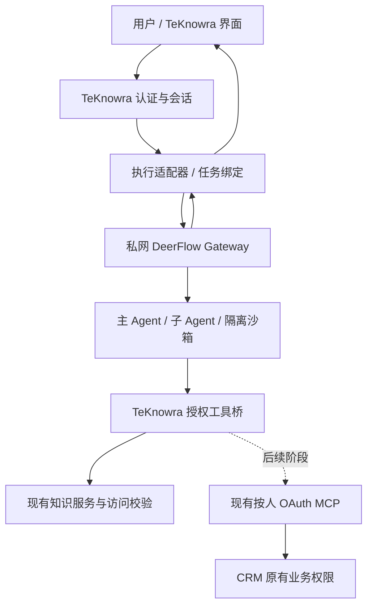

# DeerFlow 接入 TeKnowra：身份、知识授权与任务执行

日期：2026-09-24。状态：待用户审阅的设计稿；尚未实施、联调或上线。

后续修正：本稿与后续执行边界草稿均未获实施确认。最新源码推演见 `D:/TeKnowra/research/TeKnowra-DeerFlow源码静态推演-2026-09-24.md`；其中修正了身份传递、知识范围接口和重构必要性的判断。以下内容只供历史参考。

范围调整：当前近期建议以《2026-09-24-agent-execution-boundary-design.md》为准。本稿保留为未来远程执行方案参考，不作为立即实施完整融合的要求。

## 1. 目标与范围

用户已选择保留 TeKnowra 企业平台，以 DeerFlow 补强复杂任务执行。用户继续使用 TeKnowra 登录、智能体、会话和知识库界面；选用 DeerFlow 的智能体由 DeerFlow 主导规划、委派、工具调用和交付。

成功标准：同一入口完成“检索企业知识 + 分析附件 → 委派子任务 → 带引用报告与文件”，用户能查看进度、取消任务、重新连接并下载产物；用户之间、空间之间不能借助执行引擎扩大数据访问权限。

本稿建议首期仅开放已登录 Web 用户的指定智能体。普通快速问答继续走现有路径。匿名嵌入、IM、定时任务、CRM 写操作分别接入，不能假定它们具备 Web 用户身份。现有 CRM 宿主登录流程保持其已有集成契约。

## 2. 已核实依据

- TeKnowra 基线为 `090342fc5d6eacaea9a73e3f615e3725eb1f9d4b`；本地已有未提交变更不纳入此集成。
- `internal/handler/session/qa.go` 的 AgentQA/executeQA 管理请求和事件；`internal/application/service/session_agent_qa.go` 组装智能体与知识范围，`agent_service.go` 创建本地执行引擎。
- `internal/types/principal.go` 明确：Principal 用于调用者隔离，不自动赋予 RBAC 权利。它支持 Web、API、IM、嵌入等多种主体。
- 共享智能体的资源空间可以不同于调用者空间；现有代码用 resolveRetrievalTenantID 等逻辑解析，不能简单替换为调用者空间或创建者身份。
- `internal/mcp/manager.go` 的 OAuth 客户端按 principal 分缓存；现有 CRM 按人授权链必须复用，禁止降级为共享服务账号。
- DeerFlow 参考代码固定为 `fc26204debe2808fa1b4064f8fddfea6db2c71f8`，是研究基线，不代表已验证部署版本。
- DeerFlow 的 `auth_middleware.py` 有 Internal Auth + owner header；它负责可信宿主身份接入，不能代替 TeKnowra 资源授权。
- DeerFlow RAGFlow provider 采用外部知识引擎、只读检索、受控范围与引用结果。可借鉴分工和返回结构，不直接复用其全局 API key 作为 TeKnowra 多用户权限方案。

来源：
- https://github.com/bytedance/deer-flow/blob/fc26204debe2808fa1b4064f8fddfea6db2c71f8/backend/app/gateway/auth_middleware.py
- https://github.com/bytedance/deer-flow/blob/fc26204debe2808fa1b4064f8fddfea6db2c71f8/backend/packages/harness/deerflow/community/ragflow/tools.py
- https://github.com/bytedance/deer-flow/pull/5238
- https://github.com/bytedance/deer-flow/pull/4998
- https://github.com/bytedance/deer-flow/pull/5289

## 3. 方案选择

| 路径 | 优点 | 代价 | 选择 |
|---|---|---|---|
| TeKnowra 后端适配 DeerFlow Gateway，工具通过授权桥回调 | 复用执行服务、保持企业入口、边界清晰 | 需适配事件与任务状态 | 推荐 |
| 另建 Python 服务直接嵌入 DeerFlow harness | 定制自由 | 需自行承担更多持久化、文件、取消与接口工作 | 暂不采用 |
| 跳转/嵌入 DeerFlow 完整界面 | 演示较快 | 双会话、权限和用户体验更难统一 | 不作为产品集成方案 |

## 4. 身份与授权

### 4.1 两个方向的凭据

TeKnowra → DeerFlow：TeKnowra 后端复用 DeerFlow Internal Auth，并设置经后端映射的 owner。DeerFlow 仅私网可达；网络/代理限制可调用的路由。内部凭据只存服务端配置，不送浏览器、模型、提示词、沙箱或运行记录。

owner 使用持久化随机标识映射 `(TeKnowra 实例, 调用者空间, principal 类型, principal ID)`，加唯一约束。不能使用邮箱、昵称或未经验证的请求 header；共享智能体的创建者不得成为运行 owner。缺少有效映射时拒绝，禁止回退 DeerFlow 默认用户。

DeerFlow → TeKnowra：新建受限的运行授权桥。TeKnowra 保存运行授权记录，DeerFlow 可信适配器只持有短期随机能力令牌；服务端保存令牌摘要。令牌绑定 owner、session、run、智能体、知识范围、允许操作和有效期。取消、结束、权限失效立即撤销；续期重新校验授权。

能力令牌不能进入可序列化的 LangGraph state、checkpoint、tool 参数、trace 或沙箱环境；由可信运行层按执行实例获取并附加到请求。多 worker 或恢复后通过受认证的运行绑定重新取得，不能把线程 ID 本身当作授权凭据。子 Agent 只能继承或缩小父任务授权。

### 4.2 知识访问范围

每次知识工具调用的有效范围是以下范围的交集：

1. TeKnowra 当前解析出的调用授权：包括合法的共享智能体/共享知识关系；
2. 智能体配置允许的知识资源；
3. 本轮显式选择的知识库、文件、标签范围；
4. 创建运行时保存的范围上限；
5. 若调用入口有额外 capability 限制，也必须满足。

未选择范围与“明确不使用知识库”是不同状态。空交集不搜索；无法确认权限时拒绝，不回退搜索所有知识库。

复用 TeKnowra 现有授权解析，抽取成服务层可调用的共同策略，不能只绕过 Gin 路由守卫后调用底层搜索。所有文档、切片、引用和附件读取都走同一策略。资源归属空间与当前调用者同时保留，不伪装成资源空间管理员。

权限变化影响后续调用：取消共享、移除成员或禁用用户后，正在运行的任务停止并撤销授权，后续轮次不得沿用旧知识范围。既有上下文可能已含撤销前读取的内容，因此范围缩小时必须新建 DeerFlow 线程，不复用旧 checkpoint；当前运行的后续输出、产物发布与下载也需重新授权。已经合法交付给用户的历史内容无法追溯收回，需明确历史保留政策。

首期按当前 TeKnowra 已有权限粒度实施，不宣称补齐通用文档 ACL。文件选择过滤只是进一步缩小范围，不能代替源系统文档权限继承。

## 5. 首期知识工具与模型

以下是拟新增契约，不是现成 DeerFlow/TeKnowra API：

- `teknowra_search(query, mode, limit)`：模型只给检索意图；范围与身份由可信运行层补充。
- `teknowra_read_source(source_handle, offset, limit)`：按本次授权读取原文和邻接片段。

返回稳定的运行内 source_handle、文档标题、正文片段和必要定位信息。TeKnowra 保存 handle 到真实资源的映射，绑定 owner 和授权，不把上游请求局部 cN/dN 编号当作跨运行资源 ID。跨工具合并引用时统一去重与编号；无证据的声明不能伪造引用。

知识库仍由 TeKnowra 管理，不复制索引、不将数据库凭据交给 DeerFlow。模型配置首期采用管理员预配置的 DeerFlow 模型别名与 TeKnowra 模型选择映射，未映射即返回配置错误；不把用户保存的模型密钥写进任务。是否增加统一模型代理作为后续独立事项，避免首期扩大范围。

公网搜索为显式工具权限：机密文档内容不能被自动作为公开搜索查询发送；隔离沙箱的出网仅开放已配置用途，企业 API 必须经过授权桥。沙箱不持有 TeKnowra、CRM 或 DeerFlow 内部管理凭据。

## 6. 任务、事件与文件

智能体增加 execution_backend 选择（默认现有内核，指定智能体可选 deerflow）；会话建立时固定执行后端，切换后端创建新会话，避免将不同内核的工具历史混用。功能开关默认关闭。

TeKnowra 保存本地会话/消息与 DeerFlow thread/run 的持久绑定，包含 owner、资源授权摘要、幂等键和状态。任务提交先建绑定再发起远端调用；超时通过幂等键/运行状态对账，不能盲目重新执行。

统一状态：queued、running、waiting_input、cancel_requested、cancelled、succeeded、failed、interrupted。运行结束与结果验收分别记录；DeerFlow 返回 succeeded 不代表所有交付要求通过。

适配事件：主任务进度、子任务开始/结束、工具开始/结束、答案增量、引用、文件、等待输入、错误和终止。映射到 TeKnowra event bus，保存事件序号，断线重连去重；不宣称所有远端事件均可原样兼容。第一阶段所有当前 UI 已暴露的取消/重连路径必须路由到对应执行后端；steer/审批尚未接通时明确隐藏或禁用对应入口，不能悄悄落回原引擎。

关闭浏览器与明确取消分开处理。取消先撤销桥授权，再请求 DeerFlow 停止父/子任务并确认终态；不能把本地 SSE 关闭当成取消完成。网关重启后对账已有 run，无法安全恢复时标记 interrupted，不能重复触发工具副作用。

附件由 TeKnowra 鉴权后上传到绑定的 DeerFlow 工作区；产物由 TeKnowra 代理下载或导入已有受控存储。下载重新校验用户、会话与授权；不公开 DeerFlow 任意路径或永久可访问文件地址。

## 7. CRM 等业务工具的后续接入

DeerFlow 只接入 TeKnowra 的业务工具桥；桥恢复原调用者 principal，调用现有 MCPManager 和 OAuth token store。CRM 最终仍按当前用户的业务权限判定。

缺少 OAuth 时进入等待授权状态，通过现有 TeKnowra 授权入口完成后恢复同一运行，不重新创建任务。拒绝授权、主体不支持或令牌失效均明确返回，不回退共用账号。共享智能体的 MCP 配置归属与 OAuth token 的调用者归属必须分别解析。

有写副作用的工具继续经过审批和幂等约束；首期不开通邮件发送、合同回写、CRM 修改。CRM 雪花 ID 在桥、JSON、前端及审计中全程为字符串。

## 8. 拟修改边界

| 范围 | 改动职责 |
|---|---|
| `internal/application/service/session_agent_qa.go` | 在授权与配置解析后选择执行后端，避免让原 Agent 再决策 DeerFlow 的每一步 |
| 新增执行适配器与接口 | DeerFlow client、任务绑定、幂等、对账、取消与事件转换 |
| `internal/handler/session/` | 接入现有 SSE、取消、重连和错误呈现 |
| 新增授权桥路由/服务/存储 | 短期运行授权、实时范围校验、知识读取与审计 |
| 智能体类型、配置与编辑页 | 后端选择及能力展示，旧配置默认原内核 |
| DeerFlow 独立扩展包 | 两个知识工具、可信运行上下文、子 Agent 授权传播 |
| 迁移与部署配置 | 运行/owner/授权映射，私网服务和配置开关 |

以上是职责级设计；具体 schema、路由和事件字段在实施计划中按固定源码逐项锁定。优先独立扩展，只有插件钩子不足时才维护小范围 DeerFlow fork。不得把尚在 RFC 的全栈插件或 Skill 自演进接口当作当前依赖。

## 9. 验收与阶段划分

首期完整交付：指定 Web 智能体 → 身份隔离 → 受控知识工具 → DeerFlow 主/子任务 → SSE 与引用 → 附件/文件 → 取消/重连。首期通过再加入 CRM 只读工具与 OAuth 暂停恢复，最后逐项加入需审批的业务写操作和其他入口。

必须通过的测试：

1. 用户 A 无法读取/取消用户 B 的 thread、run、产物或引用；同用户切换空间不能混用状态。
2. 猜测 KB、文档、切片、文件、run ID 不能越权；伪造 owner/tenant/scope 参数无效。
3. 共享智能体只获得既有分享允许的资源；取消分享与成员移除后后续工具调用和交付被拒绝。
4. 子 Agent 和批量任务不能扩大父任务知识范围；配置空范围不变成全库搜索。
5. 能力令牌过期、撤销、串用到其他 run 均失败；checkpoint、日志与模型输入不含令牌。
6. 提交超时重试不重复建任务；断线重连不重复消息；取消覆盖子任务；重启后可对账。
7. 撤销权限后旧上下文不用于新运行；知识范围缩小时切换到新 DeerFlow 线程。
8. 带附件的真实任务生成可下载文件和可核验引用；不将任意路径当产物。
9. 同模型、同知识/工具、同业务任务比较当前内核与 DeerFlow 的完成率、人工干预、耗时及用量；记录结果，不预设提升倍数。

联调在本地独立 Linux 容器和隔离沙箱完成，不占用其他系统基础设施端口。发布仍遵守接管手册：CI 构建、固定镜像、VerifiedRelease、验证实际镜像与公网交互，不在生产构建。

## 10. 待审阅决策

推荐确认本稿的首期范围：**现有 TeKnowra 界面 + 指定 Web 智能体切换 DeerFlow + 只读知识授权桥 + 完整任务/文件闭环**。CRM 按人 OAuth 保留明确后续接入契约，首期不引入写操作。

本稿不等于实现完成或上线授权。下一步为具体实施计划与本地开发，按风险完成权限、任务恢复和浏览器验证。
