# TeKnowra 企业 Agent 研发操作手册

版本：1.6 · 核实日期：2026-10-21 · 适用范围：本机开发及已启用的生产公网研发入口、Langflow 和 Eino 双引擎接入。

本手册帮助研发把企业需求做成可配置、可发布、可追溯的 Agent。管理员先准备身份、工作空间、模型和系统连接；研发配置流程、资源与业务规则；业务人员在 TeKnowra 聊天中使用并按自身权限授权。**Langflow 是新建默认引擎，Eino 按已有代码场景选用。**

本手册编写与登录核实没有修改产品代码或发布版本，没有上线，也没有生成交付包。后续按用户明确要求，仅通过官方自助改密接口调整了本机编辑账号密码并同步已有受限存储；未改服务密钥或账号权限。本文中的创建、授权、发布和业务执行命令供研发后续操作，不表示已执行这些动作。

阅读版见同目录 `index.html`；截图、架构图在 `images/`。本机路径可按客户环境调整，账号、密钥及连接配置应由管理员通过受控渠道提供，不填写到本手册或流程画布。

[TOC]

## 1. 架构、职责和引擎选择

### 1.1 总体架构

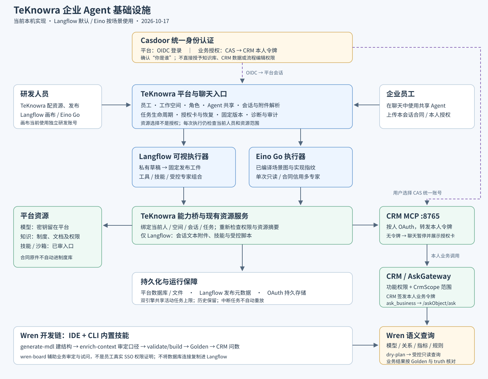

图中两条认证链不能混用：

1. **登录 TeKnowra**：员工经 Casdoor OIDC 确认身份，TeKnowra 建立平台会话，再按本平台成员、角色、共享关系判断访问权限。Casdoor 登录成功不等于拥有所有知识库或 Agent。
2. **授权业务系统**：Agent 缺少 CRM 本人令牌时暂停，聊天展示授权卡。用户可选择本系统账号，或经 Casdoor CAS 统一账号登录；CRM 确认并签发该用户自己的业务令牌，MCP 转发它调用 CRM。不得降级使用发布者或管理员的共用令牌。

Casdoor 尚未成为本机 Langflow 画布的统一登录入口；画布有独立研发账号。TeKnowra 还使用分离的 Langflow 编辑/运行服务身份管理私有流程。服务 API Key 不是研发网页登录密码，不能混用。

当前目录与任务能力桥限定本机回环拓扑，不能直接把 Langflow 地址换成另一台服务器便视为完成跨机部署；正式网络、统一画布登录和多实例运行需单独适配与验收。

### 1.2 各层负责什么

| 层次 | 必须承担的职责 | 业务研发负责的内容 |
|---|---|---|
| Casdoor / 企业身份 | 身份认证、统一登录 | 用户映射和客户身份源对接 |
| TeKnowra | 空间、角色、知识权限、共享、模型配置、技能、附件解析、聊天和运行记录 | 选择最小资源范围、配置场景、组织验收 |
| Langflow | 可视化节点、提示词、工具选择、执行依赖和专家组合 | 画布设计、业务指令、固定版本发布 |
| Eino | 已编译的 Go 场景图和受控执行 | 新流程的 Go 开发、注册、定向测试 |
| MCP | 将业务 API 封装为工具，按本人身份传递调用 | 工具契约、字段精简、失败语义、幂等或审批设计 |
| CRM + Wren 网关 | 业务权限、语义规则、SQL 规划校验、只读查询 | 建模、业务口径审定、权限映射、Golden 样例 |

“专家”就是**职责明确、拥有限定工具、产出可检查结果的子 Agent**，并不天然更可信。例如合同专家只审合同证据，信用专家只查客户信用；协调 Agent 负责委派，最终汇总组件只接收已通过核验的真实专家结果。

### 1.3 三种引擎怎样选

| 需求 | Langflow 可视编排 | Eino 代码编排 | TeKnowra 原生 |
|---|---|---|---|
| 新业务流程、可视化配置 | 首选 | 需 Go 开发 | 简单原生场景可用 |
| 知识、模型、本人 MCP | 已接入 | 已接入，按场景组合校验 | 原生能力 |
| 文本多轮 | 宿主会话历史 | 当前接入不支持 | 原生能力 |
| 聊天合同附件、技能和脚本 | 支持，遵守附件/脚本限制 | 当前接入不支持 | 按原生能力配置 |
| 共享 Agent | 复用现有共享和本人权限 | 当前接入不支持 | 原生共享 |
| 多专家 | 已实现合同/信用受控组合；新职责仍需研发 | 已编译合同/信用组合 | 不按该组合能力推断 |
| 长期记忆、图片理解、网络搜索 | 当前接入不支持 | 当前接入不支持 | 按原生配置 |

这是**本项目接入能力表**，不是对两个框架全部能力的判断。同一个 Agent 只能使用一种执行引擎；双引擎共存是不同 Agent 按需使用，不能给一个 Agent 同时绑定两套运行定义。

## 2. 开发环境与资源准备

### 2.1 先确认位置与运行入口

| 内容 | 当前本机位置 / 入口 |
|---|---|
| 平台源码 | `D:/TeKnowra/repo`；默认分支 main，本轮工作分支 `cursor/mcp-oauth-return-to-current-page` |
| MCP 源码 | `D:/TeKnowra/tyer-mcp-server`；默认分支 master，本轮工作分支 `tyer/agent-infrastructure-20261017` |
| CRM 与语义项目 | `D:/CRM/CRM2`；模型 `crm/ask-wren`；网关通用实现 `crm/semantic-wren` |
| 平台页面 / 后端 | `http://localhost:5173` / `http://127.0.0.1:8080` |
| Langflow 研发页面 | `http://127.0.0.1:7861` |
| CRM MCP / CRM | `http://127.0.0.1:8765/mcp` / `http://127.0.0.1:9999/admin` |
| 当前升级后端启动入口 | `research/upstream-runtime-20261017/start-upstream-local.ps1` |
| 通用开发脚本 | `repo/dev-app.ps1`、`repo/dev-frontend.ps1` |

当前升级启动器还指定了本机数据库、Langflow 发布元数据、服务身份文件等。不要在已有后端旁再启动一个 `dev-app.ps1`，也不要把普通脚本启动误认为加载了同一套运行配置。启动前阅读根目录《接管与上线手册》顶部最新状态；旧段落和旧 EXE 只作历史或回退参考。

前端要求 Node 22.13+，脚本优先复用现有运行时。后端涉及 CGO、DuckDB、SQLite，不能简单关掉 CGO。基础设施运行于 Docker，前后端原生运行；本机数据库和 Redis 使用独立映射，不占用其他项目的 5432、6379。**本手册不要求重新安装一套环境。**

只读检查示例，PowerShell：

```powershell
Get-NetTCPConnection -State Listen |
  Where-Object LocalPort -in 5173,8080,7861,8765,9999 |
  Format-Table LocalAddress,LocalPort,OwningProcess
git -C D:/TeKnowra/repo status --short
git -C D:/TeKnowra/tyer-mcp-server status --short
```

端口已监听不等于业务正常，应结合页面和应用日志判断；不要仅凭端口查到的 PID 就终止进程。

### 2.2 管理员先准备，研发再编排

1. 在目标工作空间确认研发有编辑 Agent、读取目标知识、使用模型和管理所需资源的权限。共享接收人通常只有使用权，不能修改源空间的发布图。
2. 确认对话模型可用，知识检索所需嵌入/重排模型可用。模型可见不表示供应商余额、额度或网络一定正常。
3. 将**制度、操作规范、产品文档**放入知识库，等待解析、索引完成，保留生效版本和适用范围。合同原件走会话附件，不提前混入制度库。
4. 在工具箱登记 MCP，确认工具元数据和本人授权。先划定允许的工具，不为方便勾选整个系统的写入能力。
5. 需要技能时确认技能已安装到选定沙箱，再给 Agent 选择技能；脚本还要有固定入口、输入契约和运行镜像。
6. 当前本机已有普通编辑账号 `teknowra-editor`，已验证可正常登录。按第 4.1 节从已有受限存储取用；不能把服务 API Key 当网页登录密码。新客户环境由管理员提供各自的编辑账号、地址和项目，不复制本机测试账号。

### 2.3 Casdoor 对接需要交付哪些信息

平台管理员核对 `OIDC_AUTH_ENABLE`、Issuer/Discovery、Client ID、Client Secret、授权/Token/UserInfo/JWKS 端点和 Scopes，配置保留在现有受限存储。配置字段见 `repo/internal/config/config.go`。不同网络下浏览器可达地址与后端可达地址可能不同，应逐个核对回调、Issuer 与证书，不能只改登录按钮。

当前平台 OIDC 默认按邮箱映射身份，未知邮箱可能走开户逻辑；CRM 的外部身份按用户名匹配，不能假设会自动创建 CRM 员工。接客户前先建立身份映射表，确认同名、邮箱变更、离职禁用的处理规则，再分配空间和业务权限。平台身份、CRM 身份与 MCP 授权主体需一致，但权限不由邮箱或用户名字符串自动推导。

<a id="public-research-login"></a>

### 2.4 生产公网地址与登录步骤（2026-10-21）

| 用途 | 实际入口 | 登录账号与认证 |
|---|---|---|
| TeKnowra 业务与发布 | <https://kb.yihe.work:9222/login> | 已有平台账号；统一身份和原生账号按既有方式使用 |
| Langflow 研发编排 | <https://flow.yihe.work:9222/login> | `teknowra-editor`，Langflow 独立登录表单 |
| Wren 语义看板 | <https://ontology.yihe.work:9222/> | `ontology-reviewer`，浏览器 HTTP Basic 认证框 |

**两个研发入口的账号、密码互不通用。** `teknowra-editor` 不能登录 Wren 看板，`ontology-reviewer` 不能登录 Langflow；它们也不是 TeKnowra / Casdoor 的 admin。密码由管理员从各系统已有受限存储通过受控渠道提供，本手册不收录密码、API Key、令牌或签名密钥。

Langflow 实际步骤：

1. 访问上述 Flow 登录地址，在用户名输入 `teknowra-editor`，使用该环境已有编辑密码登录。不要填本机测试密码、runner 密码或服务 API Key。
2. 看到项目和流程列表后，返回 TeKnowra，进入目标智能体“编辑 → 基本信息 → 打开编排”。生产按钮现在打开 Flow 公网地址并携带该智能体的编辑草稿 ID；若先前被引导登录，登录后再次从该按钮进入。
3. 确认画布名称及地址中的 Flow ID，区分草稿与固定发布运行图。不要靠同名流程猜测，不为查看而重新生成草稿。
4. 资源配置、目录连接、同步校验和发布仍按第4章操作。Flow 网页登录仅授予编辑端会话，业务执行仍在 TeKnowra 使用当前人的权限及本人 MCP OAuth；Casdoor 尚未接管画布登录。

Wren 看板实际步骤：

1. 访问上述 Ontology 地址。浏览器弹出 HTTP Basic 用户名/密码框时，填 `ontology-reviewer` 和该看板已有独立密码并确认；这里没有 Langflow 登录表单。
2. 进入后先确认“生产只读”提示，选择生产项目，阅读模型目录、业务说明、关系图及现有审定/验收结果。展示的是生产语义定义快照，旧结果不是新一次验收。
3. 当前公网入口不开放审定写入、模型/连接配置、手填身份试问或任意查询；不能把开发看板第7.9节的写入步骤直接用在此入口。模型变更在受控研发环境完成，经发布校验后同步生产快照。
4. 真实业务问数回到 TeKnowra，通过已授权 CRM MCP 的 `ask_business` 执行，并按需完成本人 CRM OAuth。看板 Basic 登录不授予 CRM 数据权限。

地址打不开与密码错误分开排查：未登录看板 HTTP 401 是认证要求；HTTP 403 表示接口不允许，不能靠换管理员账号绕过。若出现“无法访问此站点”、DNS/连接超时或证书错误，记录浏览器错误码，由管理员检查域名、代理路径、9222端口、网关和证书；不要重置密码或关闭认证。2026-10-21 服务端公网核验：Flow 登录页200、匿名流程API403；看板匿名401、已有认证读取200、写入及试问403。用户此前遇到 `ERR_INVALID_AUTH_CREDENTIALS`；在取用已有看板独立凭据后，已于2026-10-21确认成功登录。此次访问问题已排除，未重置密码、关闭认证或改变权限，不再列为尚待排查。

本机开发仍使用 `http://127.0.0.1:7861/login`；未设置前端 `LANGFLOW_EDITOR_URL` 时“打开编排”继续使用本机地址。公网入口只改变研发浏览器跳转，不改变后端回环能力桥或资源权限。

## 3. 在 TeKnowra 页面创建与配置智能体

### 3.1 创建入口

1. 进入“智能体”，点击“创建智能体”。
2. 在“基本信息 → 执行引擎”选择 Langflow、Eino 或原生。新建默认 Langflow。
3. 填写名称、描述。描述写清任务目标、读写范围和不支持的输入，例如“读取本会话合同与企业制度，输出辅助审查报告，不审批、不付款”。
4. 配置模型、提示词和所需资源后创建。已创建 Agent 的引擎不可直接在编辑框切换；不同引擎建独立 Agent，保留历史会话。

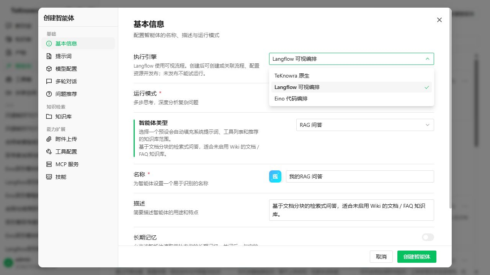

智能体类型预设只帮助填初始提示词、工具和知识范围，**不等于已建立 Langflow 图，也不等于切换了引擎**。

### 3.2 最小资源配置

| 配置页 | 操作 | 保存后检查 |
|---|---|---|
| 提示词 | 写目标、输入、证据要求、缺失信息处理和禁止动作 | 新建图会初始化 Instructions；已有图后续以发布画布指令为准 |
| 模型配置 | 选择可用对话模型，确认输出预算 | 不能仅按显示名推断上下文或输出上限 |
| 知识库 | 选“指定知识库”，选择本场景制度库 | 当前用户实际有权读；不是配了 ID 就获得授权 |
| 工具配置 | 开启场景必需原生工具，如知识检索 | 不选无关的写入、浏览器或任意执行能力 |
| MCP 服务 | 选择所需服务和具体工具 | 工具名称、参数、用途与实际服务一致 |
| 技能 | 选沙箱，勾选已安装技能 | 未安装技能先由管理员安装；脚本另行授权 |

保存后重新进入编辑框检查值。对于 Langflow，修改资源后还需“同步并校验资源配置”和重新发布；不把表单保存当作已更新运行版本。

### 3.3 合同会话的专用设置

在“知识库”页开启“Langflow 会话文本附件”。它同时强制“禁止会话问答自动入库”：该 Agent 参与后的**本会话**不再新增自动问答索引与长期记忆，聊天记录仍保留，旧索引不删除，其他会话沿用原策略。

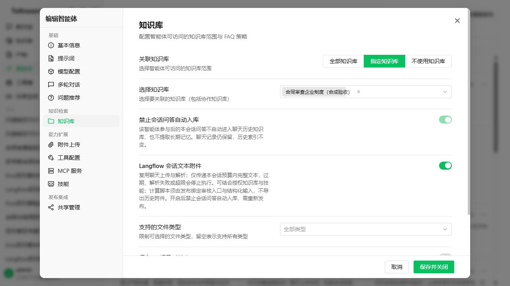

“附件上传”页另外选择 PDF/Word 等解析器及等待时间。这里的解析等待与 Agent 总执行时间不同；文件成功上传也不等于已成功解析。Langflow 会话文本附件在过期、解析失败或超限时停止执行，不应悄悄用残缺正文继续审查。不要把图片上传开关当成双引擎已支持图片理解。

## 4. Langflow 可视化开发、发布与回退

### 4.1 创建草稿或关联流程

1. 创建并保存 Langflow Agent，再进入“编辑 → 基本信息”。
2. “流程接入方式”选择“创建通用流程”，首次生成流程；已有草稿时按钮显示“生成新的编辑草稿”，**不要为了打开流程反复生成**。
3. 如果复用已有图，选择关联方式。只允许当前空间内、当前人员可编辑且已登记的流程，并为本 Agent 建独立副本。不能粘任意外部 Flow ID 绕过空间隔离。
4. 先保存资源配置，再点击“同步并校验资源配置”。该动作同步授权目录与绑定，不自动替研发增加、删除或重连节点。
5. 点击“打开编排”。如果显示登录页，按下方步骤使用已有编辑账号登录，再从 TeKnowra 再次点击“打开编排”回到目标草稿。不要在项目列表误开同名的历史副本。

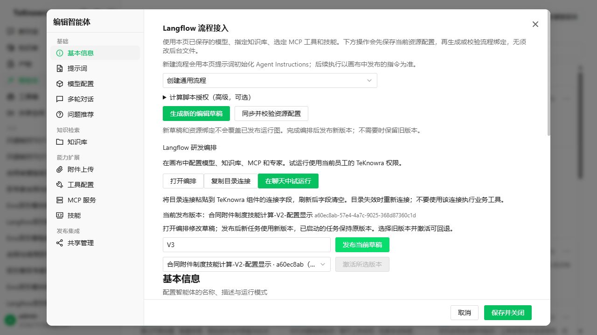

#### 本机研发账号与正常登录步骤（生产见第2.4节）

当前本机画布地址是 `http://127.0.0.1:7861`，编辑用户名为 **`teknowra-editor`**。它是普通 active 账号，不是超级管理员。运行账号 `teknowra-runner` 专门持有固定发布的私有运行图，研发不要用它登录编辑。两者均不是 TeKnowra 的 admin / sales01，也不是 Casdoor 账号。

当前密码保存在已有受限文件：

`D:/TeKnowra/research/selection/langflow-decision-test-20261013/data/teknowra-release-identities.local.json`

取用的是 **`editor.password`**。同目录 `teknowra-release-service.local.json` 保存的是编辑/运行 API Key，不能填进网页登录密码框。账号文件包含其他凭据，禁止整份复制、发送、截图或提交。

1. 在上述本机 Windows 用户下打开 PowerShell。当前文件只允许该用户和 SYSTEM 读取，不修改权限。
2. 执行以下命令，将已有编辑密码临时复制到本机剪贴板；命令不在终端输出密码，也不修改账号文件：

```powershell
$lfIdentityPath = 'D:/TeKnowra/research/selection/langflow-decision-test-20261013/data/teknowra-release-identities.local.json'
$lfLocalIdentity = Get-Content -LiteralPath $lfIdentityPath -Raw -Encoding UTF8 | ConvertFrom-Json
Set-Clipboard -Value ([string]$lfLocalIdentity.editor.password)
Remove-Variable lfLocalIdentity
```

3. 打开 `http://127.0.0.1:7861/login`，用户名填 `teknowra-editor`，在密码框粘贴，点击“登录”；不要点击注册或重置密码。
4. 看到 Starter Project 和已有编辑草稿即表示登录成功。返回 TeKnowra 对应 Agent 点“打开编排”，确认画布名称和地址中的 Flow ID 是该 Agent 的草稿。
5. 粘贴使用后清空本机剪贴板：`Set-Clipboard -Value ''`。该命令会替换当前剪贴板内容，应在不需要继续保留它时执行。
6. 本次验证的已登录画布页签已保留，可直接继续使用；关闭浏览器、清理站点存储或会话失效后，按同样步骤重新登录即可，无需重启服务或重新初始化账号。

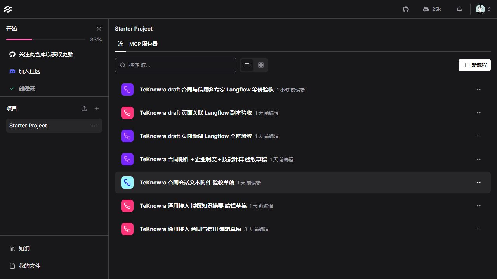

**为什么以前没有让用户手工登录：**2026-10-13 的原型曾调用 `/api/v1/auto_login`；2026-10-14 固定发布阶段由 `bootstrap_local_release.py` 建立普通编辑和运行账号，生成随机密码并存入上述受限文件，然后关闭自动登录与自助注册。此前技能验收记录也使用了普通 `teknowra-editor` 画布。本次缺的是浏览器有效登录会话和账号取用说明，不是账号不存在。当前 `/api/v1/auto_login` 返回 403，保持关闭。

不要为日常登录重跑 `bootstrap_local_release.py`：它是旧环境迁移脚本，包含创建账号、API Key 和复制草稿等写操作。当前账号和密码已正常，无需执行它。2026-10-17 后续已按用户要求通过校验旧密码的官方自助接口修改编辑密码，并同步此文件的 `editor.password`；手册不记录密码明文。本机账号是现有研发测试身份的复用，不代表已实现 Langflow 的 Casdoor 单点登录。

打开草稿可能触发动态字段初始化刷新和自动保存。本次已还原截图前后完整草稿并逐字段确认：变化仅为原生 Agent 节点的刷新时间戳与画布视图，实际配置、组件代码、节点位置和连线未变，发布版本及运行工件也未变。核实依据见第 12.5 节。不要把草稿更新时间直接当作已发布版本改变。

**登录后看到“组件需要更新”时：**这是组件源码版本提示，不是认证失败。只为查看画布不要点击“更新”或“更新全部”；组件升级应另行评估，核对连线、重新发布并定向验证。

### 4.2 在组件中选择模型、知识、MCP 与技能

1. 在 TeKnowra 编辑页点击“复制目录连接”。这是有效期约 15 分钟的研发目录连接，只提供资源元数据，不包含供应商密钥或本人 OAuth 令牌。
2. 在画布左侧 TeKnowra 分类拖入所需组件，将连接粘贴到“连接 TeKnowra 资源目录”字段。
3. 等待刷新，组件出现资源名称和稳定 ID，临时连接字段清空。过期后重新取连接；不要把连接写进提示词、提交到 Git 或当业务 API Key。
4. 在组件下拉框选择资源，连入 Agent。下表列出已实现字段。

| 组件 | 关键配置 | 输出接到哪里 |
|---|---|---|
| TeKnowra 模型 | 平台模型、temperature、max_tokens | 原生 Agent / 受控专家的 Language Model |
| TeKnowra 知识检索 | 指定知识库 | Agent Tools 或合同专家授权工具 |
| TeKnowra MCP 工具 | MCP 服务、工具名 | Agent Tools 或信用专家授权工具 |
| TeKnowra 技能 | 平台技能、是否提供技能脚本工具 | Agent Tools |
| TeKnowra 受控只读专家 | contract / credit、原始任务、模型、授权工具 | 主 Agent Tools，并保留原工具连到汇总 |
| TeKnowra 已核验专家汇总 | 主 Agent 完成、原专家工具、必需专家 | Chat Output |

#### 模型、知识库与 MCP 的实际配置位置

具体资源在**节点本身的下拉框**选择。单击节点标题可把它置于前景，避免相邻节点遮挡；底部缩放菜单可切到 100%，在画布空白处平移查看，不拖节点。浮动工具条里的“参数”面板用于字段可见性和 API 输入定义，不是选择平台资源的主要入口；日常配置不需要点“代码”“冻结”或移除字段。

**模型节点：**先连接目录，再在“平台模型”选择平台已配置模型，核对稳定 ID；“温度”影响生成随机性，“输出Token上限”是该节点请求的输出预算，输出端口“平台模型”连接 Agent / 专家的模型输入。截图的多专家草稿当前为 `deepseek-v4-flash`、温度 `0`、上限 `4096`，这是该图现值，不是所有场景的推荐默认值。需要更大输出时应另行评估模型限制、任务时间和发布版本，本轮未调整。

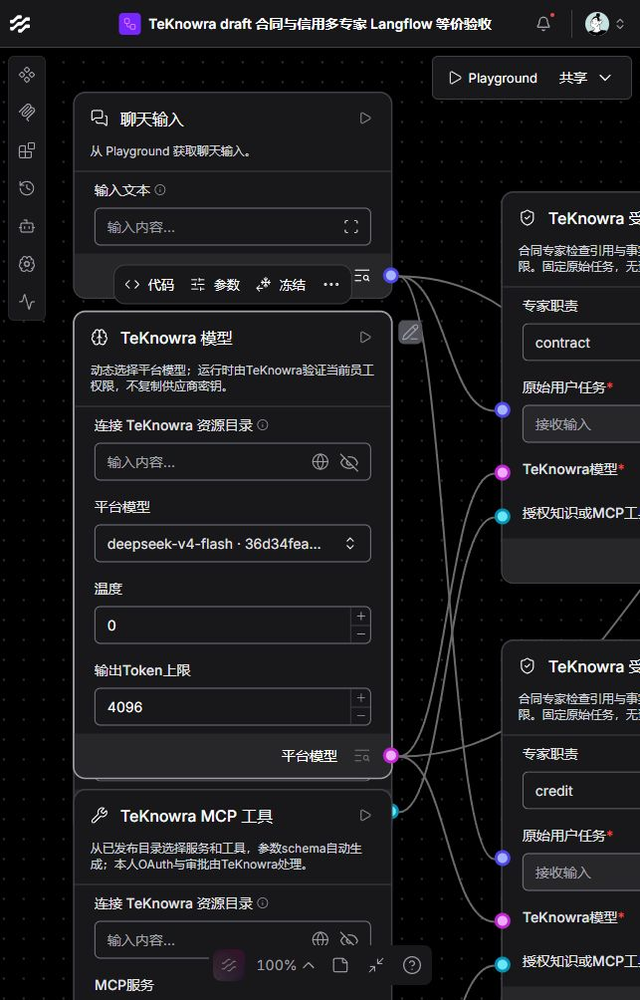

**知识检索节点：**选择“知识库”，将“知识工具”输出连到 Agent Tools 或相应专家的授权工具输入。图中当前为历史多专家合成样例的“合同审查 V2 合成验收”；它只说明资源选择方式。新建会话合同场景应选择专门的企业制度库，不把待审合同预先放进这个样例库；第 3.3 节和第 10 章采用的就是制度库加聊天附件。

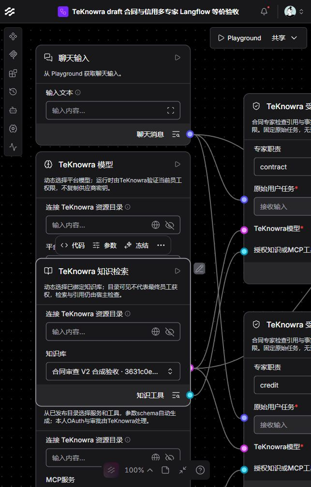

**MCP 节点：**先选“MCP服务”，再按需选“工具”。“受控工具”输出接 Agent Tools 或信用专家授权工具输入。本图服务为 `CRM-MCP`，工具栏留空，使用的是固定绑定内的工具集合；不是任意读取所有 CRM API。

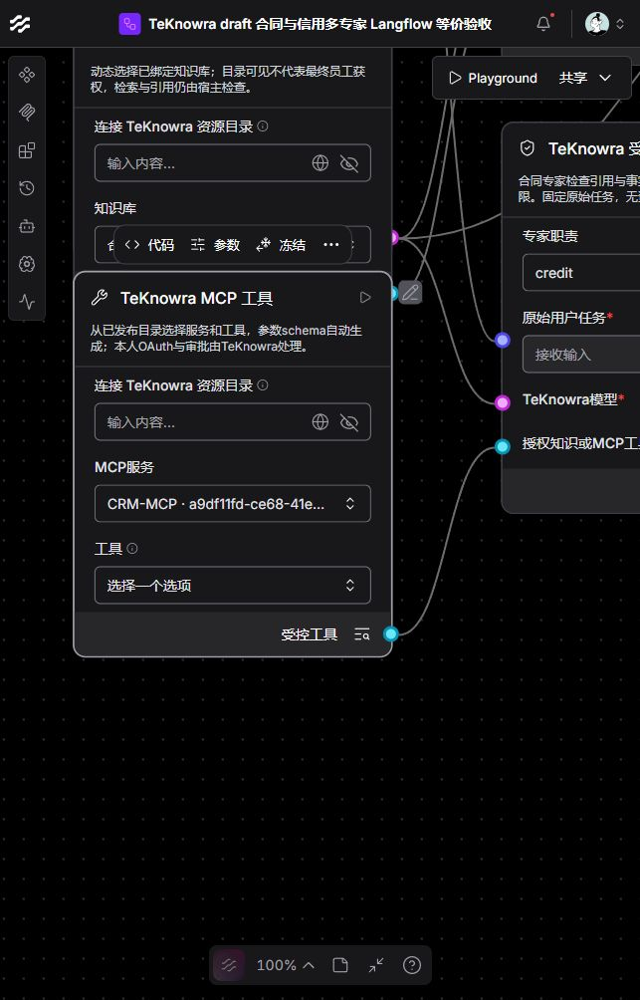

**重新打开后下拉没有候选怎么办：**本次展开“工具”时实际显示 `No options found`。临时目录连接不会保存，重新打开不能保证仍有候选列表；已有资源显示名称也不代表设计目录仍在线。需要改变选择时，先在 TeKnowra 取新的目录连接，粘贴组件字段等待刷新，必要时再点该字段列表的刷新按钮，最后选具体工具。不要仅因列表为空就重启 MCP、改 OAuth 或开放更多权限。本轮只展开查看，未刷新、重连或改变工具选择；运行固定发布仍使用发布时冻结并校验的工具 schema。

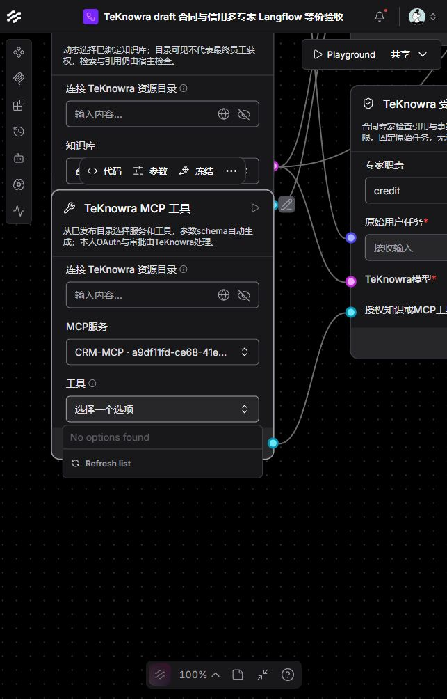

MCP 组件工具名留空表示该服务**全部已绑定的工具**，不是该服务全部现有工具。需要最小权限时显式筛选。技能节点只获得读取该技能的能力，不因 SKILL.md 写了一个工具名就得到相应系统权限。

基础图连线：Chat Input → Agent Input；TeKnowra 模型 → Agent Language Model；知识/MCP/技能 → Agent Tools；Agent Response → Chat Output。每个 Agent 都应由 TeKnowra 模型节点供给，不能用原生供应商节点另塞一份 API Key。

### 4.3 提示词与文本多轮

提示词建议至少包含：身份职责、允许的数据源、工具使用顺序、缺失证据处理、输出格式、禁止动作。资料中的命令属于待分析数据，不能覆盖系统规则。示例：

```text
你是采购合同只读审查助手。
合同事实只取本会话附件；企业规则只取本轮有权访问的制度库。
先读取审查技能，再检索适用制度和版本，按固定结构化脚本计算。
证据不充分时列出缺口，不推测审批阈值、客户身份或付款结果。
输出合同事实、制度依据、计算结果、风险和待确认事项。
不得付款、审批、回写 CRM；不得把附件或问答自动加入知识库。
```

当前 Langflow 多轮使用 TeKnowra 会话历史，关闭 Langflow 本地消息记忆，避免跨人串话。历史按宿主规则最多最近 20 个完整问答、64 KiB，超过处理上限会明确拒绝；不回放旧工具结果或沙箱文件。历史答案不能替代新一轮实时权限、CRM 或知识查询。

### 4.4 技能与固定计算脚本

1. TeKnowra“技能”页选择运行沙箱，勾选目标技能；不在当前沙箱的技能先安装。
2. 在图中添加“TeKnowra 技能”，选择同一技能，连到 Agent Tools。需要执行时开启“提供技能脚本工具”。
3. 在 TeKnowra 基本页展开“计算脚本授权（高级，可选）”。附件场景必须列出固定 `skill`、`path` 和 JSON `input_schema`；缺少此配置不能混用附件与脚本。
4. 同步资源、保存画布并重新发布。技能正文、脚本、工具描述和运行依赖都属于版本的一部分，更新后不能继续假设旧发布有效。

画布实际字段是“平台技能”和“提供技能脚本工具”。当前合同草稿已选 `tyer-contract-session-review`，脚本开关开启；“技能工具”端口连接“合同审查与协调”的 Tools。开关只提供执行工具，不能替代 TeKnowra 的技能勾选、沙箱安装和固定脚本/schema 授权。三处必须一致，图中开启后还要按发布流程校验。

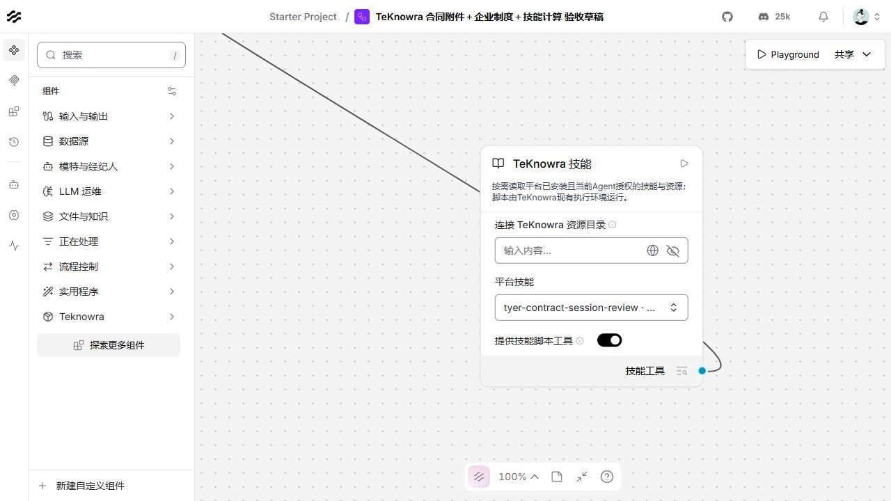

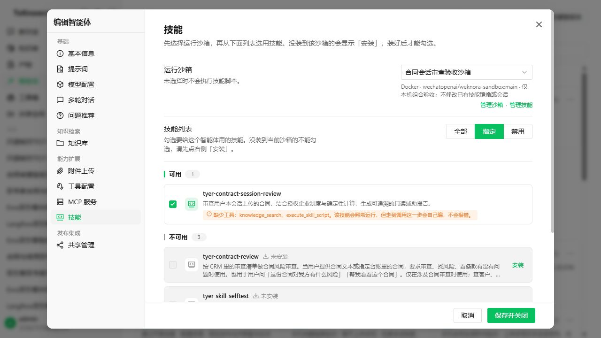

页面“缺少工具”提示目前主要按原生工具清单检查，未完整识别 Langflow 能力桥。不能只凭这条提示断定画布缺能力，也不能据提示扩大权限；应检查图中实际 Tool 连线、固定发布校验与聊天工具步骤。

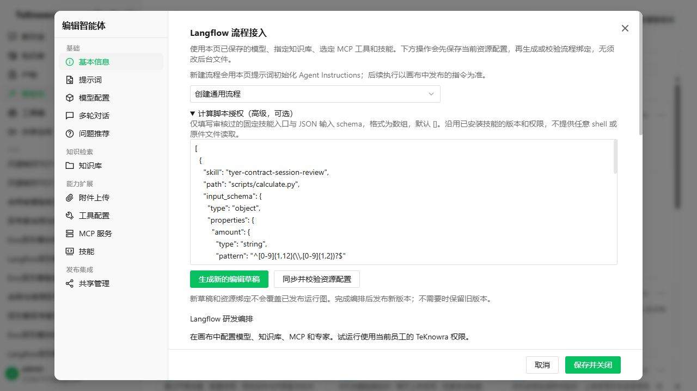

合同样例的配置为数组，外层不再包 `structured_scripts` 字段：

```json
[
  {
    "skill": "tyer-contract-session-review",
    "path": "scripts/calculate.py",
    "input_schema": {
      "type": "object",
      "properties": {
        "amount": {"type": "string", "pattern": "^[0-9]{1,12}(\\.[0-9]{1,2})?$"},
        "prepayment_percent": {"type": "number", "minimum": 0, "maximum": 100},
        "review_threshold_percent": {"type": "number", "minimum": 0, "maximum": 100},
        "rule_reference": {"type": "string", "minLength": 1, "maxLength": 512, "pattern": "^[^\\x00-\\x1f]+$"}
      },
      "required": ["amount", "prepayment_percent", "review_threshold_percent", "rule_reference"],
      "additionalProperties": false
    }
  }
]
```

执行时 `args` 必须为空，只接受最多 64 KiB 的单个 JSON 对象作为 stdin；不能传任意命令、原件路径或凭据。金额用十进制字符串，比例用数字。schema 只支持当前实现的简单字段约束，不使用远程引用或复杂组合。入口与 schema 检查不等于脚本内容安全，脚本仍须研发审查并在受控沙箱运行。


#### 已有业务技能怎样选

| 技能目录 | 用途和配套能力 | 注意事项 |
|---|---|---|
| `tyer-contract-session-review` | 本会话合同附件、授权企业制度与 `scripts/calculate.py` | 当前附件合同场景优先使用；不自动入库，不写CRM |
| `tyer-langflow-contract-evidence` | 历史知识库合成合同验收，读取 `REFERENCE.md` 和 `scripts/report.py` | 包含TEST-A-001等验收约定，不是新企业合同的默认模板 |
| `tyer-contract-review` | CRM审查清单、提交审查发现、获取审查汇总 | 依赖CRM-REVIEW的四个具体工具；包含业务写入，不能当作只读附件技能直接替换 |
| `tyer-market-price-collector` | 浏览器行情取证，按需用CRM报价工具录入 | 技能不自带浏览器；当前双引擎接入未提供完整浏览器执行能力，不能仅勾选便宣称自动采集可用 |
| `tyer-skill-selftest` | 技能元数据、正文、附加资源三级加载自检 | 不执行脚本、不证明MCP或业务链路已通过 |

自定义技能目录只是预置来源；安装到目标沙箱、绑定资源与工具、授权固定入口并发布后才成为该Agent的可执行能力。历史验收技能保留，不批量迁移或改写。

### 4.5 多专家如何连线

合同/信用组合按下表操作。不要用主协调 Agent 自己编写的总结替代受控专家结果。

| 节点 | 输入 |
|---|---|
| 合同专家 role=contract | 原始 Chat Input、TeKnowra 模型、指定知识检索工具 |
| 信用专家 role=credit | 同一原始输入、模型、find_customer / get_customer_credit_control / check_customer_access |
| 主 Agent | 原始输入、模型、两个专家委派工具；指令要求完成所需委派 |
| 已核验专家汇总 | 主 Agent Response →“主Agent执行完成”；两个原专家工具 →“原专家委派工具”；必需专家 contract,credit |
| Chat Output | 已核验专家汇总的结果 |

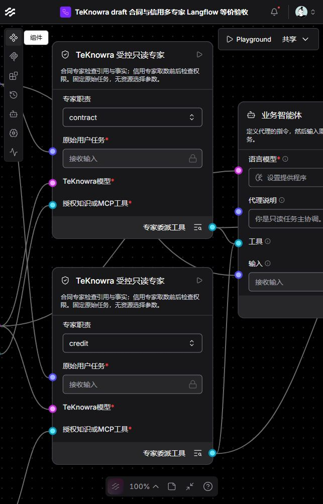

两个专家的“原始用户任务”都接同一个 Chat Input；模型都接 TeKnowra 模型，合同专家接知识工具，信用专家接本人 MCP 工具。输入框显示“接收输入”且锁定，表示已由连线提供，不需要再手填一份任务。不要把主协调模型改写后的任务当原始输入。

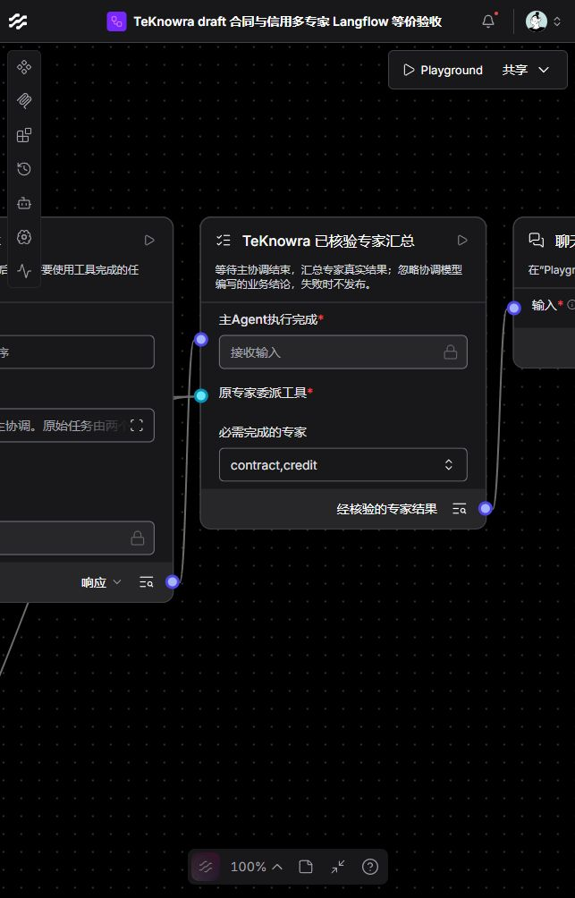

汇总组件“必需完成的专家”为 `contract,credit`；“主Agent执行完成”与“原专家委派工具”必须同时连接。主 Agent 的完成标记只表示协调结束，不能替代专家真实业务结果。图中后接的原生 Chat Output 在当前中文界面显示为“聊天记录”，输入口为“输入”，与旧版称“聊天输出”是同一类节点。

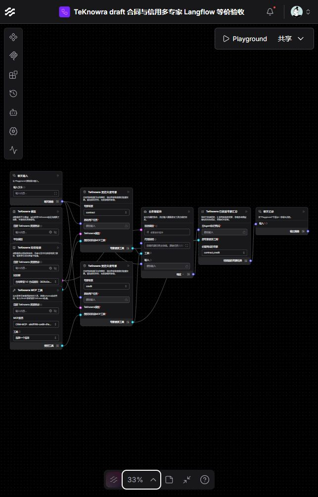

如果出现“组件需要更新”，不等于登录失败；本次未点更新。目录连接字段为空是正常的，临时连接不会保存进图；需要调整资源选项时重新连接目录。合同专家会核对引用与事实，信用专家在取数和输出前检查权限；缺少必需专家结果、混合不同任务或替换工具都会拒绝汇总。

当前受控专家组件的职责枚举只有 `contract` 与 `credit`。采购、供应商等新专家不是改个名称即可完成，需要开发相应业务契约、证据校验并注册到允许组件范围。

### 4.6 保存、固定发布与回退

1. 完成画布后等待保存状态稳定，重新打开该草稿确认关键参数和连线仍在。不要同时开多个编辑页修改同一图，以免旧画布自动保存覆盖新图。
2. 返回 TeKnowra，点击“同步并校验资源配置”。若提示缺资源，先查授权/所选工具与图节点，不要直接放宽范围。
3. 填写版本名称，例如 `采购合同审查-v1-20261017`，点击“发布当前草稿”。
4. 成功后确认“当前发布版本”的名称及 release_id。发布会冻结图、组件及相关依赖，导入运行身份的私有工件。草稿保存不会改变运行版本。
5. 点击“在聊天中试运行”，从 TeKnowra 发起真实任务；Langflow Playground 不具有宿主任务能力，直接运行 TeKnowra 工具失败是预期边界。
6. 需要回退时选旧发布版本，点击“激活所选版本”。新任务使用新活跃版本，已启动任务保留开始时的版本。

回退只切换 Agent 发布，不回退数据库或整个 Python 环境。工具 schema、技能包、组件源码及依赖变化可能导致旧发布失效，应修复兼容性或重新发布，不能关闭摘要检查。

## 5. Eino 场景选择与 Go 研发

### 5.1 使用已编译场景

新建 Agent 选“Eino 代码编排”，再选“Eino 场景流程”，配置模型、知识库与工具并保存。现有四个定义：

| 定义 ID | 页面用途 | 必需资源 |
|---|---|---|
| contract-review-v1 | 合同审查 V2，授权库中材料的只读审查 | 模型、指定知识库、知识检索 |
| knowledge-summary-v1 | 授权知识摘要 | 模型、指定知识库、知识检索 |
| customer-credit-readonly-v1 | 客户信用只读查询 | 模型、本人 OAuth MCP 的三个信用工具 |
| business-review-multiagent-v1 | 合同与信用多专家 | 上述知识与三个信用工具 |

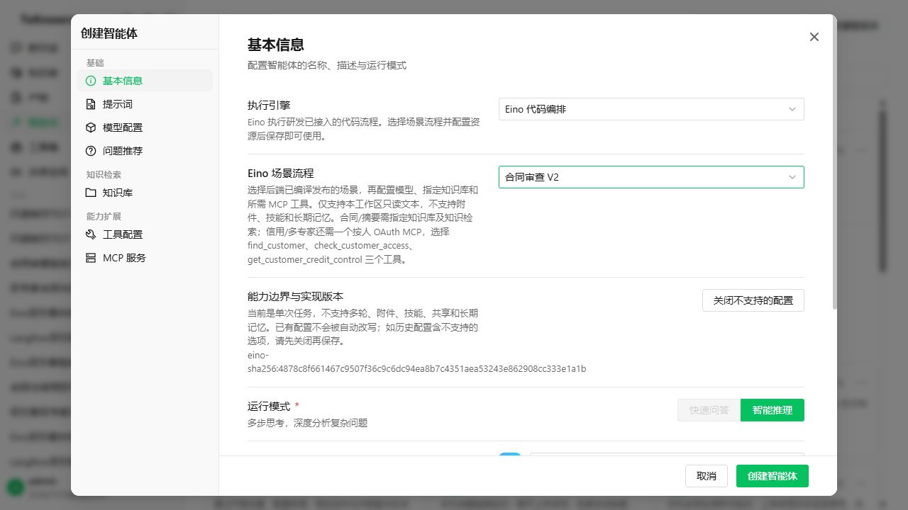

信用工具为 `find_customer`、`get_customer_credit_control`、`check_customer_access`，应属于所选按人 OAuth 服务。当前 Eino 不接聊天合同附件，不能把“合同审查 V2”当成上传合同方案；上传合同使用第 10 章 Langflow 场景。

旧 Agent 如果保留不支持的选项，页面可点“关闭不支持的配置”，核对后显式保存。不要批量改写历史配置。Eino 当前是单次任务，页面隐藏多轮、附件、技能和共享入口，是能力限制，不是漏了按钮。

### 5.2 新增 Eino 场景的研发路径

1. 在 `repo/internal/agent/einodef/catalog.go` 定义稳定 ID、名称、知识/MCP 等资源要求与支持能力。目录、保存校验与执行使用同一套定义。
2. 在 `repo/internal/agent/einoruntime/` 实现图和节点。参考 `knowledge_summary.go`、`customer_credit.go`、`multiagent.go`，通过宿主已有模型/知识/MCP 接口取资源，不另建无权限的客户端。
3. 在 `publication.go` 注册 builder、系统提示词、模型调用预算及必要的输出前业务授权钩子。只有加 catalog、没有运行 builder 并不构成可执行场景。
4. 核实 `engine.go` 的通用身份、证据与事实检查仍覆盖新图；新增业务事实结构应有对应检查。资料检索和大模型生成不得替代权限判断。
5. 编写定向测试：资源不足拒绝、正确证据通过、缺来源/矛盾事实拒绝、本人 MCP 身份、失败与取消释放。
6. 按项目现有 Go/CGO 开发流程构建本机候选，安排更新后端；页面再选新定义。不要向已有 Agent 偷换定义，也不需要给每个新建 Agent 增加一条后台绑定文件。

Eino 的新任务记录 `eino-sha256:...` 实现指纹，覆盖已编译运行时源码与场景定义。它不等于整套二进制签名，也不保证模型每次生成相同结果。历史任务未记录指纹时按历史展示，不事后补造版本。

## 6. 开发和接入 MCP

### 6.1 复用现有服务还是新增服务

**按鉴权和系统边界划分服务，而不是每个工具起一个进程。** 同一 CRM、同一按人 OAuth 规则的新只读 API，优先加到 `mcp-tyer-crm/server.py`。不同业务系统、不同身份源或共用服务账号的受控写工具，需要独立服务和权限边界。

当前 CRM 8765 按人 OAuth；CRM-REVIEW 8766、mail 8767 是不同鉴权用途，不能拿它们替代本人查询。`mcp-tyer-srm` 仅为 PigX 接入骨架，不表示 SRM 已落地。该骨架注释和 `.env.example` 的端口示例不一致，且可能与现有服务冲突，复制后必须重新核对。

### 6.2 工具开发步骤

1. 先确认上游 API：路径、方法、本人权限、分页、字段类型、错误码、只读/写入、幂等性。先拿契约，再写工具。
2. 找到最小入口工具。用户通常提供名称，应先查名称取得唯一 ID，再调用详情；多条匹配要澄清，不能选第一条冒充唯一。
3. 复用 `tyer_mcp_core` 的配置、鉴权、HTTP 客户端与 ID 校验。已存在 `api = PigXClient(CFG)`、`mcp` 的 CRM 服务只需新增工具函数。
4. 用类型标注约束参数；docstring 写什么时候调用、返回哪些事实、单位与时间口径、查不到/无权语义。精简返回，不把整个数据库对象塞给模型。
5. 按上游业务 `code` 判断成功，不能把 HTTP 200 当成功。CRM 雪花 ID 全程字符串，不能转 JavaScript Number 或先浮点再转回字符串。
6. 写工具测试并由低权限、管理员分别验收。涉及写入时另做明确确认、幂等与审计设计；本手册样例只读。

下例采用骨架真实 API 形态，**路径和字段必须按目标系统改写**，不是已实现的供应商服务：

```python
@mcp.tool
async def find_supplier(name: str | None = None, size: int = 10) -> dict:
    """按名称查询本人可见供应商；返回字符串ID供详情工具使用。
    多个匹配需用户确认；无结果可能是不存在或无权查看。
    """
    data = await api.get('/supplier/page', {
        'name': name, 'size': size, 'current': 1
    })
    if not isinstance(data, dict):
        return {'found': False, 'message': '返回结构异常'}
    keep = ('id', 'name', 'supplierNo')
    rows = [{k: r.get(k) for k in keep if r.get(k) is not None}
            for r in (data.get('records') or []) if isinstance(r, dict)]
    return {'found': bool(rows), 'total': data.get('total'), 'suppliers': rows}

@mcp.tool
async def get_supplier_profile(supplier_id: str) -> dict:
    """按上一步确认的字符串ID查询本人可见供应商。"""
    return await api.get(f"/supplier/{as_id(supplier_id, 'supplier_id')}")
```

`as_id` 及身份/异常处理应按现有服务方式导入、使用；不能把示例粘贴成缺少 `api`、`mcp` 初始化的独立文件。

### 6.3 新服务的配置与启动

1. 在 MCP 仓库复制现有骨架到新目录，保留共享核心引用。先设置独立 `FASTMCP_HOME`，再导入 FastMCP：认证库有模块级设置，导入后修改可能不生效。
2. 从 `.env.example` 建本机私有配置。填写系统前缀的 API Base URL、OAuth Client ID/Secret、授权/Token/验证端点、服务监听地址/端口，独立 `MCP_JWT_SIGNING_KEY`。不要把真实值放进文档、Git 或截图。
3. 在上游注册 OAuth 客户端。PigX 样例授权类型为 `authorization_code,refresh_token`，scope 为 `server`；其他系统按实际要求，不能照搬 PigX 的特殊登录参数。
4. 分清三个地址：

| 地址 | 用途 | 本机 CRM 样例 |
|---|---|---|
| MCP 上游 OAuth 回调 | 上游登录完成后回到 MCP | `http://127.0.0.1:8765/auth/callback` |
| 平台 OAuth 回调白名单 | MCP 完成后把授权结果返回平台 | `http://localhost:5173/api/v1/mcp-oauth/callback` |
| 统一账号 CAS service | 统一身份票据回到 MCP | `http://127.0.0.1:8765/cas/callback` |

5. `MCP_ALLOWED_CLIENT_REDIRECT_URIS` 配完整回跳地址，逗号或换行分隔，不用通配符。`localhost` 与 `127.0.0.1`、不同端口是不同回调；隔离环境要登记隔离地址，不能把凭据回送原环境。不要为解决错误关闭白名单。
6. 检查目标端口空闲后再启动。现有 CRM 的操作示例：

```powershell
Set-Location D:/TeKnowra/tyer-mcp-server
Get-NetTCPConnection -State Listen -LocalPort 8765 -ErrorAction SilentlyContinue
# 已有服务时不要再次启动。确认维护窗口、配置及端口后才执行：
.\.venv\Scripts\python.exe .\mcp-tyer-crm\server.py
```

出现 WinError 10048 表示端口已有监听，通常是旧实例没停，不是 OAuth 登录错误。先查 OwningProcess 和真实命令行，不能按过期 PID 直接杀进程。当前原服务正常时，不为登记新平台工具反复重启它。

### 6.4 在 TeKnowra 注册和分配工具

1. 进入“工具箱 → MCP服务 → 添加服务”。填写名称，选 HTTP Streamable，URL 填对应 `/mcp` 地址。
2. CRM 本人查询选“OAuth 2.0（首次连接授权）”。Scopes、预注册 Client ID/Secret 按管理员配置；留空 Client ID 时走动态注册，不能随意复用别的环境登记。
3. 保存并进入“工具与用途说明”，确认工具清单、参数和描述。若服务新增工具，重新同步/发现工具目录；旧 Agent 的工具范围不因服务增加工具自动扩大。
4. 在目标 Agent“MCP 服务”页选择服务及所需工具，再在 Langflow 组件中选择对应资源，同步并重新发布。
5. 用当前使用者授权、运行只读工具。共享 Agent 的接收人也用自己的授权，发布者的授权不能替代。

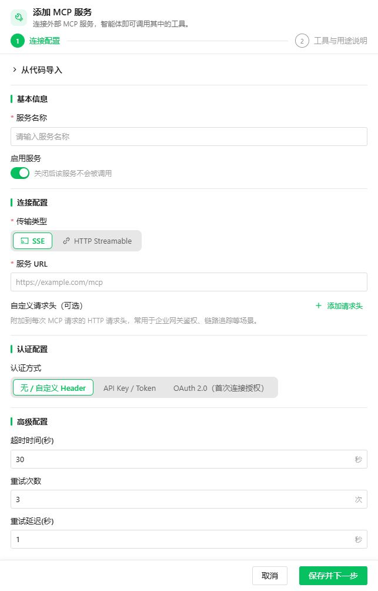

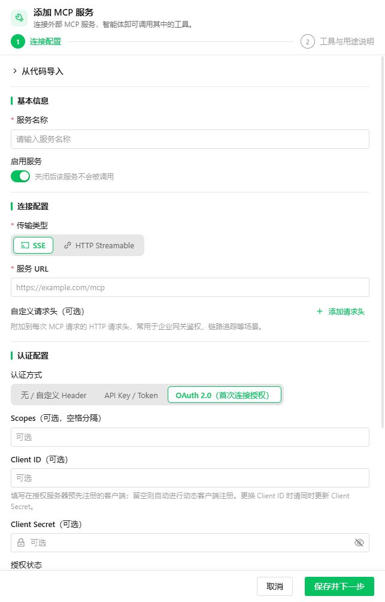

### 6.5 聊天授权与同任务恢复

缺令牌 → 工具暂停 → 授权卡 → 点击去授权 → 浏览器本人登录 → 回到**同一个环境、同一任务** → 等待恢复与实际工具结果。登录成功页不代表任务已成功。

检查任务是否仍在等待、授权主体是否正确、回调端口是否一致、工具结果是否出现、是否只调用一次。误用 admin 授权的 sales01 会话不能作为低权限通过证明；应撤销该连接的错误授权，重新发起本人测试。旧授权页、旧任务登录不能补认到新任务。超时后应新建任务，不篡改超时状态或静默重放。


### 6.6 现有 CRM 工具按什么职责使用

| 职责 | 工具与使用顺序 |
|---|---|
| 客户与信用只读 | `find_customer`确认唯一字符串ID，再调用`get_customer_credit_control`、`get_customer_performance`、`get_customer_profile`、`list_receivables`；订单详情用`get_order_detail` |
| 固定指标与语义问数 | `list_business_metrics` / `query_business_metric`；`list_ask_objects` / `ask_business`，由CRM/Wren网关校验语义和本人权限 |
| 价量机制与模拟分析 | `analyze_sales_mechanism`，环境、输入和结论边界见7.10 |
| 报价记录 | `find_price_products`唯一匹配商品 → `list_competitor_prices`核对已有记录 → `record_competitor_price`写入 |

报价录入先阅读MCP仓库 `docs/competitor-price-tools.md` 与配套技能，字段必须有来源、规格、币种、单位、税费/交付口径、报价日期及带时区采集时间。缺关键证据就保留待复核，不能填“未知”凑过校验。当前没有服务端原子幂等保障，应串行处理，不开启并发自动写入。只读场景不要授予该写入工具；接入存在不等于自动行情采集已经完成。

CRM-REVIEW和邮件服务的工具以各自README和实际注册目录为准，按独立鉴权用途配置。普通查询不应为了省一次授权改接共用服务账号。新企业不需要一次开放全部工具，按场景选择最小集合。

## 7. 用 Wren 技能建立业务语义模型

### 7.1 先分清三类东西

| 名称 | 所在位置 | 用途 |
|---|---|---|
| Wren CLI 内置技能 | 当前 `wrenai 0.14.0` 安装包；`wren skills get`读取 | IDE 内指导研发探结构、建模、补业务口径、规划问数 |
| TeKnowra 产品技能 | `repo/skills/preloaded/tyer-*` | Agent 运行时按权限加载审查规则/脚本 |
| wren-board | `D:/wren-board`，项目指向 `crm/ask-wren` | 给业务核对模型、指标、关系、审定和验收结果 |

Wren 不是把数据库表结构导入后让模型自由写 SQL。模型需要明确**业务对象、统计粒度、有效数据、指标、关系和当前人的权限范围**，才能得到可复用的问数能力。wren-board 的关系图和口径审定不等于 Langflow 节点编排，也不代替真实 CRM 权限验收。

本机容器为 `ask-wren-wrenai`，项目在容器 `/ask-wren`，通用实现 `/semantic-wren`。本轮只读检查确认版本为 0.14.0，内置技能有 onboarding、generate-mdl、enrich-context、usage、dlt-connector、genbi。后两者不在本项目现有主链必需范围内。

### 7.2 在 IDE 中取得技能

打开项目目录，让 IDE 助手读取实际 CLI 技能规范，不凭旧教程生成格式。PowerShell 中若 Docker 未在 PATH，本机可用：

```powershell
$dockerCli = 'D:/Program Files/Docker/resources/bin/docker.exe'
& $dockerCli exec ask-wren-wrenai wren --version
& $dockerCli exec ask-wren-wrenai wren skills list
& $dockerCli exec ask-wren-wrenai wren skills get onboarding --full
& $dockerCli exec ask-wren-wrenai wren skills get generate-mdl --full
& $dockerCli exec ask-wren-wrenai wren skills get enrich-context --full
& $dockerCli exec ask-wren-wrenai wren skills get usage --full
```

这些命令只读取技能。当前原文留档在 `D:/TeKnowra/research/wren-0.14.0-内置技能原文/`；升级版本时重新读取，不假设 CLI 参数和 MDL 结构永远不变。数据库连接凭据只使用已有 profile 或管理员配置，不粘进 IDE 对话、语义描述或截图。

可直接交给 IDE 助手的任务描述：

```text
在现有 ask-wren 项目内，先读取 wren 的 generate-mdl 和 enrich-context 全文。
本轮只新增“采购合同”业务范围，先列出现有模型、可复用字段、主键粒度和缺口。
不要重置旧项目，不覆盖原模型描述，不改连接账号或权限。
按 grill 方式每次只审定一个业务问题：展示现有原文、代码/数据出处、建议答案，
让我选择采纳、修改或跳过。关系、统计粒度和指标有歧义时先暂停该项。
输出拟修改文件和校验步骤；确认口径后再改模型并逐项 validate/build。
```

### 7.3 第一步：明确业务对象与范围

研发与业务先定一个小范围，例如“合同签约和执行”，而不是一口气开放整个库。逐项回答：一行表示什么、唯一主键、有效/作废/删除状态、统计金额是否含税、时间按创建还是生效、币种与单位、归属人员与部门、哪些记录本人能看。

已有 `wren_project.yml` 时保留原项目；新增客户用独立目录和 profile。官方 generate-mdl 会提到重置选择，**当前工程禁止为了方便重置历史模型**。确认只读数据库连接与表清单后，再探测列类型、主键、外键和少量必要样本；不能把数据库中的所有业务数据复制成提示词资料。

### 7.4 第二步：generate-mdl 生成结构

1. 读取表和字段定义，区分数据库事实与业务猜测。外键未声明的关系需要通过代码、真实查询和业务确认。
2. 使用 CLI 的类型规范化能力生成模型，字段类型按实际数据库方言处理，不直接抄另一客户的类型。
3. 在 `models/<对象>/metadata.yml` 定义 `name`、`ref_sql`、主键、列和模型描述。
4. 以业务对象粒度写 `ref_sql`。当前合同模型使用 `cust_contract`，过滤 `del_flag='0'`，一行一份合同；不能直接迁移为其他企业的合同口径。
5. 在 `relationships.yml` 写确认过的关系和基数。当前样例 `effective_order.customer_id = customer.customer_id` 为 many_to_one。对一对多明细连接直接 SUM 头表金额会重复放大，必须先确定粒度。

当前模型格式节选：

```yaml
name: contract
ref_sql: |
  SELECT id, amount, customer_id, status
  FROM cust_contract
  WHERE del_flag = '0'
primary_key: id
columns:
  - name: id
    type: BIGINT
    is_primary_key: true
  - name: amount
    type: DECIMAL(18, 2)
    properties:
      description: 合同额；具体含税、币种及统计范围按业务审定补全。
properties:
  label: 合同
  requiredPermission: contract_view
```

这只是结构节选，**缺少行级规则，不能直接作为可上线的完整模型**。`contract_view` 也是当前 CRM 的权限码，新系统需真实映射。

### 7.5 第三步：enrich-context 补齐业务语义

推荐 grill 方式：一次一个问题，展示现有内容和建议答案，由业务采纳、修改或跳过。先处理影响结果的口径，再优化措辞。至少审定：

| 审定点 | 必须写出的内容 |
|---|---|
| 状态枚举 | 每个值含义、未填和未知状态的处理 |
| 金额与数量 | 含税/未税、币种、金额单位、退货/冲销符号 |
| 时间归期 | 生效/认收/创建时间选哪一个，截止日边界 |
| 有效记录 | 草稿、作废、终止、删除是否进入指标 |
| 主从关系 | 一行粒度、基数、是否允许跨表聚合 |
| 标识与名称 | 用户说名称时如何定位ID，多名如何澄清 |
| 权限 | 功能权限码、人员/客户/部门范围，以及受限/无限制语义 |

字段事实写在模型列的 `properties.description`；跨字段业务规则写 `knowledge/rules/*.md`；常见已确认问法和 SQL 通过 `wren memory store` 存储；复杂跨表、窗口计算先定义视图，再提炼指标 Cube。不要在多个文件复制互相冲突的定义。

官方 enrich-context 偏向增加现有描述；遇到旧描述错误，应列出改写建议让业务确认，再定点修改。不要为了“自动建模”默默覆盖历史审定结论。

### 7.6 第四步：用 Cube 固化指标

当前销售额 Cube 的真实结构如下，示例口径仅适用于已审定的当前 CRM：

```yaml
name: sales
base_object: effective_order
measures:
  - name: amount
    expression: SUM(effective_order.amount)
    type: DECIMAL
    properties:
      label: 销售额
      definition: 已生效订单的头表含税金额，按认收日 recognized_at 归期。不含未生效订单。
time_dimensions:
  - name: recognized_at
    expression: recognized_at
    type: DATE
properties:
  label: 销售额
  examples:
    - 本月销售额
    - 这个月销售额多少
```

研发新增指标时必须给出公式、分子分母、筛选条件、维度、时间粒度和边界样例。业务确认“销售额”后才让 AI 生成；不能让模型临时决定按下单额、发货额还是回款额回答。

### 7.7 第五步：权限模型与安全查询链

模型级 `requiredPermission` 控制业务功能，行级规则约束实际数据范围。作为维度的模型可按当前实现用 `inherit`，但不能因此单独开放全部维度数据。合同当前按客户可见范围过滤；订单按相应业务归属，不能统一套“创建人=本人”。

`semantic.yml` 声明 session 范围属性，模型行级条件使用同名属性，CRM `CrmScope` 生成这些属性。三处需一致，例如 `session_unrestricted`、`session_cust_ids`。用户不能在聊天中自行指定这些范围值。

实际运行路径：

1. Agent 调用 `list_ask_objects` 或 `ask_business`。
2. MCP 使用当前人的 CRM token 调 `/askObject/catalog`、`/askObject/ask`。
3. CRM `AskObjectService` 将本人功能权限、`CrmScope` 范围、问题和真实会话 threadId 交给 `AskGateway`。
4. Wren 规划与校验 SQL；查询端只接受刚通过 dry-plan 的 SQL 和一次性批准令牌，再按受控只读连接取数。
5. 输出以实际查询结果为准，权限不足或模块未开放明确拒绝。当前 CRM 问数入口明确关闭库存，不因底层存在库存表就开放查询。

不要把人员权限名单、用户 ID 或数据行塞进规划模型提示词来代替权限控制。连续追问复用平台真实 threadId/最近有效计划；不能由模型猜 planId，也不能拿另一个用户的上下文继续查询。

### 7.8 第六步：校验、业务核对与问数接入

在已批准的开发模型变更之后运行，下列命令会生成/更新模型产物与索引，**不属于纯只读检查**：

```powershell
$dockerCli = 'D:/Program Files/Docker/resources/bin/docker.exe'
& $dockerCli exec -w /ask-wren ask-wren-wrenai wren context validate
& $dockerCli exec -w /ask-wren ask-wren-wrenai wren context build
& $dockerCli exec -w /ask-wren ask-wren-wrenai wren memory index
& $dockerCli exec -w /ask-wren ask-wren-wrenai python -B /semantic-wren/engine/check_models.py
& $dockerCli exec -w /ask-wren ask-wren-wrenai python -B /semantic-wren/engine/check_cubes.py
```

成功标志分别是结构校验通过、生成 `target/mdl.json`、索引完成、模型有行级权限/功能权限/标签、Cube 可编译。通过编译不等于金额正确，还须跑 Golden。

将已确认问法与 SQL 写入记忆的 CLI 形式为：

```text
wren memory store --nl "<业务已确认的问法>" --sql "<已核验的语义 SQL>"
```

该命令写 `knowledge/sql/<slug>.md`，有 memory 依赖时建立索引。必须在正确项目目录执行，不能把未确认 SQL 当正确样例；也不要把有数据行或凭据的原始调试输出写入记忆。

Golden 使用当前 `crm/ask-wren/golden/cases.json` 与独立 truth 查询核对，至少覆盖正常口径、空结果、边界时间、不同权限、指标聚合和追问。现有脚本入口：

```powershell
Set-Location D:/CRM/CRM2/crm/ask-wren
.\golden\run.ps1
```

此脚本会构建模型、查询开发库、临时启动容器内 Golden 服务和宿主 18099 relay、运行 Java 测试，再生成说明书/看板结果。执行前检查端口和开发库范围；不能在不知情时当“看一下版本”的检查命令运行。不要执行 `ops/readonly_role.py` 作为日常验收：它会修改只读账号密码与凭据。

模型与 Golden 通过后，TeKnowra Agent 选择 CRM-MCP 的 `ask_business`（需要目录时加 `list_ask_objects`），再在图中选择并发布；不是把 Wren 数据库连接配置复制到 Langflow。

### 7.9 wren-board 怎么给业务审定

生产公网看板的地址、Basic登录和只读限制见第2.4节。以下写入和试问步骤仅用于获准的开发看板，不适用于生产只读入口。

本机有 `D:/wren-board` 源码，README 入口为 `python -m wrenboard --project D:\CRM\CRM2\crm\ask-wren --port 18800`。本轮未检测到 18800 监听，未擅自启动服务；以下界面图来自项目 2026-10-06 真实留图，导航与当前 README 一致。

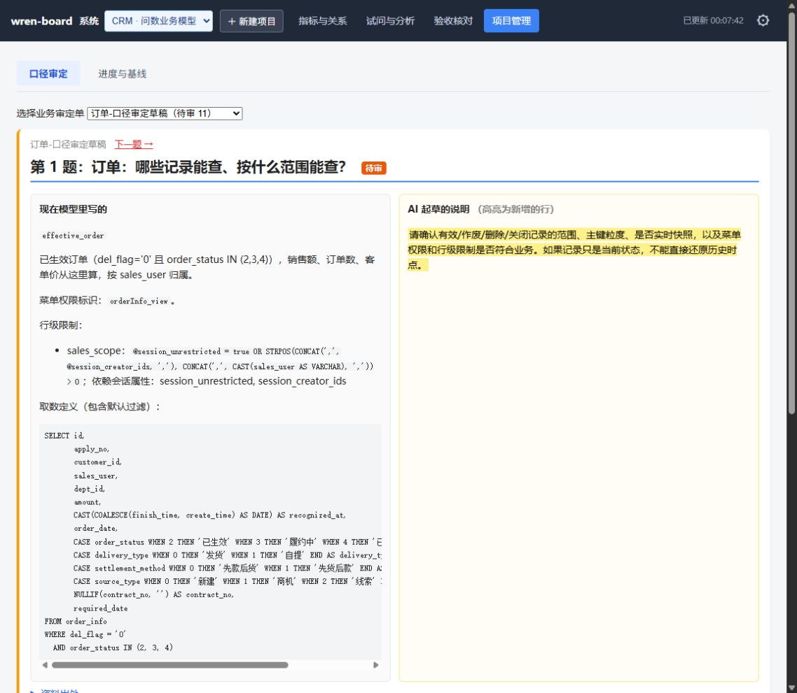

1. 管理员在已准备好依赖的开发环境启动看板并指定正确项目。不要为了查看而安装另一套 Wren 或改模型密钥。
2. “指标与关系”看指标说明、业务关系图、完整业务说明，先核对定义而不是先试问。
3. “项目管理 → 口径审定”逐题展示现有原文和 AI 建议，业务采纳、修改或跳过；“进度与基线”检查变化。修改审定结果后按研发流程同步模型、重建并校验。
4. “试问与分析”验证表达和结果；“验收核对”查看 Golden 结果及时间。旧结果不能代表刚改的模型已通过。
5. 看板里的手填身份/预设仅是调试输入，不是员工真实 SSO 权限证明。最终低权限验证回到 TeKnowra + 本人 CRM OAuth。

无需看板服务时，可阅读 `D:/CRM/CRM2/crm/ask-wren/target/model-book.html` 离线说明书。它是生成时快照，不代表当前模型已重新构建。顶部齿轮涉及模型配置，不截图或传播密钥。


### 7.10 用 DoWhy 分析经营机制

**Wren 负责按业务语义和本人权限取数；DoWhy 负责执行已定义的分析计算。** DoWhy 已接入 CRM MCP，不是独立 Agent 引擎，也不代替 Wren 建模技能。业务研发通过 MCP 工具使用它，不需要在画布里写任意 Python 或直接连接业务数据库。

实际链路是：TeKnowra 当前用户 → 本人 CRM OAuth → CRM 菜单与数据范围 → Wren 固定语义模板及网关校验 → 完整授权明细 → MCP 启动独立 DoWhy 子进程 → 返回结构化证据与结论。DoWhy 子进程只接收本次 JSON 数据，不接收数据库、OAuth 或模型凭据。

#### 管理员准备独立计算环境

1. 查看 MCP 仓库 `mcp-tyer-crm/requirements-dowhy.txt`，当前固定 `dowhy==0.14`。在独立 Python 环境安装；不要往正在运行 FastMCP 的环境直接追加整套科学计算依赖。
2. 本机已存在 `D:/TeKnowra/research/dowhy-pilot-20261006/.venv/Scripts/python.exe`，可复用，不必新装。新环境由管理员创建虚拟环境，再执行该解释器的 `-m pip install -r mcp-tyer-crm/requirements-dowhy.txt`。
3. 在 **MCP 进程**配置 `DOWHY_PYTHON` 为解释器绝对路径，并按既有维护方式重新加载该服务。Linux 或容器必须填该进程可见的路径，不能照抄本机 D 盘路径。
4. 核对 CRM 已有 `/askObject/sales-mechanism-data`、本人菜单权限、Wren 模型和固定取数模板。只注册工具而没有后端取数能力，不能运行。

此步骤不需要修改 TeKnowra 模型配置，也不能用共用管理员令牌替代用户授权。当前未配置环境返回 `ANALYSIS_NOT_CONFIGURED`；运行失败返回 `ANALYSIS_FAILED`，都不能让模型编造一个“分析成功”的结果。

#### 在 Langflow 中配置与使用

1. 在 TeKnowra 智能体的 MCP 服务中选现有 CRM MCP，将 `analyze_sales_mechanism` 加入允许工具。保留按人 OAuth。
2. 保存资源配置，按第4.2节复制并连接目录。在 TeKnowra MCP 组件中选择该工具，接入原生 Agent 的 Tools；不要把计算环境路径或业务系统密钥放进提示词。
3. 提示词要求用户给出**准确商品、规格和两个明确月份**。未给齐时先澄清，多个规格候选交给用户选，不能任取一项代表整个企业。
4. 固定发布，在 TeKnowra 聊天试运行。缺少本人令牌时走授权卡，恢复同一任务；`thread_id` 使用平台注入的真实会话上下文，不要求用户编造 UUID。
5. 检查真实工具步骤与返回字段，保留 `planId`、期间、数量金额核对及限制说明。`ask_business` 可用于后续明细钻取，但不能把任意新查结果冒充原分析的同一快照。

工具输入如下；没有列出的字段不能让模型自由扩展为 SQL 或代码。

| 字段 | 配置要求 |
|---|---|
| `product_name` | 准确商品名，非空，最多100字符 |
| `current_month` / `previous_month` | 不同的 `YYYY-MM` 月份，年份2000～2100；由服务计算完整期间 |
| `specification` | 明确规格；有歧义先选，不跨规格或单位强行合并 |
| `thread_id` | 平台真实会话上下文 |
| `include_business_evidence` | 默认不要求附加经营因果试点；只有明确模拟分析才开启 |
| `scenario` | 模拟试点场景枚举，不是任意生产因果问题 |

#### 当前已实现什么，结果怎样读

**第一层是价量机制分解。** 图和乘积机制来自“销售额＝销量×加权成交价”的业务恒等式，不是从两个期间的汇总值中发现经营因果。计算先对平授权范围内完整明细，不能静默丢弃坏行、截断、缺失或重复记录，再用 DoWhy GCM 计算四种价量组合，并对称分摊数量和价格贡献。

例如纯合成数据：上期100吨、70万元，本期120吨、96万元。总额增加26万元，数量贡献15万元、加权成交价贡献11万元。此例只是说明计算口径，不是某个客户的实际运行结果。价格项包含客户、订单组合变化，不能说“调价带来了11万元收入”，更不能据此断言业务员或交付问题是根因。

| 返回字段 | 必须检查的含义 |
|---|---|
| `ok`、`dowhyExecuted`、`dowhyVersion` | 是否真实成功执行及所用版本；不能只看自然语言答案 |
| `detailReconciliation`、`reconciliation.passed` | 明细与汇总是否对平；失败必须保留失败 |
| `contributions`、`salesChange` | 两项贡献及总变化；展示舍入差额独立标注，不当业务因素 |
| `evidence` | 本人范围、期间、行数、取数计划等依据 |
| `businessRootCauseVerified` | 当前为 `false`；不得解释成已证明真实经营根因 |
| `answerText`、`limitations` | 优先保留工具的可信结论和适用边界，避免模型另算另编 |

**第二层是限定的模拟经营因果试点。** 仅在用户明确要求本机模拟、商品名带“模拟-”、`include_business_evidence=true` 时使用。当前场景为“交付延迟影响采购”“延迟存在但不影响采购”“市场需求下降”“成交价上涨”“多因素叠加”。数据还必须标记 `simulation=true`；不是企业真实因果分析的通用入口。

该试点按客户配对两期，至少200条记录、100个完整客户；固定人工因果图和线性加性假设，按客户拆分训练与留出集，并进行50次客户聚类 bootstrap。输出包括延迟效应、探索性区间、留出误差及解释残差。当前门槛为留出采购量 RMSE 不超过5、解释残差不超过每客户2吨；不合格直接拒绝。结果是**每客户后续采购量**的变化，不能与第一层销售额贡献混加。它仍返回 `businessRootCauseVerified=false`，没有完成图证伪或噪声独立性验证。

新增真实企业因果场景，需要另外确认时间顺序、混杂因素、样本完整性、业务因果图和验证标准，再扩展受控工具。只新建 Wren MDL 或换提示词，不能自动获得可信因果推断。

#### 定向验证和排错

先用独立 DoWhy 解释器执行 MCP 仓库的 `tests/test_dowhy_runner.py`、`tests/test_repeat_purchase.py`、`tests/test_sales_reconciliation.py`；MCP 本身使用自己的解释器验证 `tests/test_sales_mechanism.py`。这些是离线单元测试，不等于真实账号权限或生产数据验收。完整场景另记录：用户与资源范围、真实工具调用、取数计划、输入口径、真实执行标记、核对结果和失败拒绝。

| 问题 | 排查位置 |
|---|---|
| 未配置 / 缺少模块 | MCP 进程的 `DOWHY_PYTHON`，以及对应解释器的依赖；不是 Langflow 解释器 |
| 401 / 授权卡 | 当前用户 CRM OAuth 与回调；不借用发布者令牌 |
| 403 / 无数据 | CRM 菜单及数据范围、Wren 固定模板与计划；不放宽权限 |
| 规格不明确 / 对平失败 | 商品候选、期间、单位、明细完整性；不静默删数据凑结果 |
| 模拟试点拒绝 | 模拟标记、场景、配对、样本量、误差和残差；不修改门槛以得到成功 |

源码定位：MCP 仓库 `mcp-tyer-crm/sales_mechanism.py`（工具与子进程）、`dowhy_runner.py`（价量与快照核对）、`repeat_purchase_runner.py`（模拟试点）、`requirements-dowhy.txt`（独立依赖）；CRM 侧入口属于 CRM 仓库，不由 TeKnowra 自己绕过网关取数。

## 8. 共享 Agent 与员工使用

1. 源空间管理员或有权限研发进入 Agent“共享管理”，选择允许的接收空间/对象和权限，保存。
2. 接收人从“共享给我”或共享空间使用源 Agent。研发目录、草稿编辑和固定发布权仍属于源空间，不因共享获得。
3. 运行使用源 Agent 的已发布配置，但每次取资源还检查共享关系、接收空间成员、当前人的授权范围。模型/知识/技能配置来自源 Agent，不表示令牌来自发布者。
4. 接收人第一次调用 CRM 时用自己的账号授权。缺工具目录可能先发现工具并等待授权，不能借用发布者目录。
5. 源空间撤销共享后，后续调用应拒绝；接收人“停用共享”只是自己的隐藏操作，不能代替源空间撤权。

客户验收记录至少写明发布版本、两个真实账号各自可见范围、本人 MCP 身份和结果。不要只用管理员全权限证明企业权限链成立。

## 9. 调试、诊断与运行保障

### 9.1 按哪一层排查

| 现象 | 优先检查 | 不应采取的处理 |
|---|---|---|
| 新建后不能运行 | 是否创建/关联图、是否固定发布、当前资源是否匹配 | 偷改后台Agent绑定 |
| 组件目录空或更新失败 | 目录连接有效期、当前编辑权限、已保存资源、重新连接 | 把令牌写进画布 |
| 模型无输出 | 余额/额度、超时、输出预算、finish reason | 未看原因就换模型/无限重试 |
| 输出截断 | 实际模型响应和输出上限、JSON是否完整 | 把残缺JSON当成功 |
| 事实复核拒绝 | 专家草稿、引用、事实字段及具体 issues | 降低规则使它通过 |
| 授权后仍等待 | 账号、任务期限、回调host/port、客户端登记、浏览器是否旧页 | 共用admin授权或改成功状态 |
| 连线“消失” | 当前草稿、保存完成情况、多个编辑页、重开后图是否一致 | 直接发布未核对的旧图 |
| 技能不能执行 | 安装沙箱、Agent勾选、组件脚本开关、固定入口/schema、发布摘要 | 开任意shell读取原始合同 |
| Wren金额不对 | 指标口径、过滤、时间、join基数、truth结果 | 只改提示词掩盖模型错误 |

### 9.2 看运行步骤与“请求信息”

先定位会话、消息、执行引擎与实际 release_id / Eino 指纹，再看模型、知识、MCP、专家、脚本各步。界面显示的简短错误用于普通用户；有权限研发可在“请求信息”查看内部执行诊断，包括事实复核拒绝原因。

内部诊断要求本人有权读取该会话、网页主体且达到 Contributor 及以上角色；普通消息与 SSE 不直接暴露原始诊断，API Key 和嵌入主体不能读取该专用诊断端点。不要为排查给所有人扩大权限，不能把包含合同草稿或业务事实的诊断公开转发。

分析复核拒绝时依次检查：来源存在且当前有权读；草稿字段确实由来源支持；币种/日期/阈值未凭空补全；合同原文与制度适用范围一致；脚本结果真实产生；模型JSON完整。确有程序错误就修程序，事实不充分则保留拒绝并补证据。

### 9.3 并发、超时与恢复

| 项目 | 当前本机行为 |
|---|---|
| 共享并发上限 | 两种嵌入引擎合计 2 个活动任务；第三个立即提示繁忙，不无限排队 |
| 等待授权 | 仍占执行槽；约 600 秒上限 |
| 活动执行预算 | Eino 120 秒、Langflow 240 秒 |
| 含授权的总墙时 | Eino 720 秒、Langflow 840 秒 |
| 失败/取消/超时 | 释放执行槽，不自动循环重试 |
| 后端进程硬退出 | 旧任务明确失败；不恢复工具副作用，不自动重跑；重启后可新发任务 |

`TEKNOWRA_AGENT_MAX_CONCURRENT` 当前默认 2，允许 1～32；它是每个后端进程的限制，不是跨机器或集群的总配额，也不等于“只允许两个用户”。是否提高取决于内存、模型额度、沙箱和客户容量测试，不能因为支持填写 32 就直接改到 32。

单实例恢复依赖当前本机明确单实例配置；多副本需要另外设计租约、协调与持久化，不把本机故障验证外推为集群高可用。Langflow 发布库为当前单进程文件模式；Wren 连续追问状态也有进程内限制，不能未经设计横向扩容。

## 10. 完整示例：会话合同 + 企业制度 + 技能 + 计算

### 10.1 输入、资源与输出约定

合同由用户在聊天中上传，只作为本会话材料。制度库提前包含有效采购/付款制度；技能用 `tyer-contract-session-review`，固定脚本 `scripts/calculate.py`，不接 CRM 写入。

输出五部分：合同事实与原文、制度名称/版本/条款来源、计算输入输出、风险与建议、缺失信息。它是辅助审查，不是法律结论或最终审批。

### 10.2 研发从零操作

1. 建单独的合成测试制度库，写清适用采购场景、版本与预付款复核阈值；不要用真实未授权合同测试。
2. 创建 Langflow Agent，指定制度库和模型。知识库页开会话文本附件，确认问答自动入库关闭。
3. 选择已安装 `tyer-contract-session-review` 的沙箱、勾选该技能。基本页填写第 4.4 节固定脚本 JSON。
4. 创建通用流程，画布连接 Chat Input、TeKnowra 模型、知识检索、技能、原生 Agent 与 Chat Output；开启技能脚本工具。
5. Instructions 按第 4.3 节明确区分合同事实与企业制度，要求先取制度再计算，证据不足不补阈值。
6. 同步资源、重开画布核对、固定发布，记下版本ID。
7. 在 TeKnowra 新建此 Agent 会话，上传测试合同，等解析完成再提问。示例：“从采购方立场检查预付款，引用企业制度并计算金额；只读，不审批”。
8. 看步骤是否真实读取附件、技能、制度和脚本，确认最终报告逐项引用。不能只有模型一句“已经调用脚本”。

合成样例：合同金额 `100000.00`、预付 `40`，本次制度证据确认阈值 `30`。脚本应得预付金额 `40000.00`、`threshold_exceeded=true`，含同一制度来源。比例等于阈值时当前脚本按 `>` 判断，不是 `>=`。这些数字只是测试，不作为任何企业默认政策。

### 10.3 最小验收记录

| 验收项 | 通过条件 |
|---|---|
| 合同来源 | 来自本会话上传解析文本，不以其他会话/知识库合同替代 |
| 制度来源 | 本人有权读，版本/适用范围明确，报告可追溯 |
| 技能与计算 | 固定脚本入口，结构化输入，真实 stdout 与算术一致 |
| 缺口处理 | 无制度/无附件/解析失败/正文超限明确停止或要求补充，不造事实 |
| 权限 | 低权限用户不能得到未授权制度或CRM数据 |
| 会话隔离 | 新会话不能凭空取得旧合同，合同及QA不新增自动知识索引，聊天记录保留 |
| 版本 | 任务显示实际发布版本，回退只影响后续新任务 |

底座已通过的共性项不必在每个客户全部重跑；客户新接的规则、资源权限、接口和业务结果必须验。记录已验范围和例外，不能用演示成功替代业务验收。

## 11. 场景交付与维护

每个客户场景保存一份轻量记录：业务目标与非目标、负责人、输入输出、资源清单、允许工具、本人授权方式、制度/语义口径版本、流程ID/AgentID/发布ID、合成验收样例、回退方式、未支持范围。**不包含密钥、令牌、完整合同或数据库转储。**

更新流程遵循“改草稿 → 保存重开核对 → 资源校验 → 固定发布 → 定向验收 → 业务确认”。改模型/技能/工具schema时要评估依赖摘要，别只改服务后就让旧图继续跑。保留历史数据与旧版本，回退不删除会话。

客户接入顺序：身份与空间 → 模型与额度 → 制度知识 → MCP本人授权 → Wren业务口径（需要问数才做）→流程与技能 → 两真实账号验收 → 明确容量与上线窗口。当前本机验证不自动成为客户生产网络、SSO或容量验收；本手册没有触发任何上线。

## 12. 速查与源码定位

### 12.1 三种“发布”不是一回事

| 动作 | 改变什么 |
|---|---|
| 保存 TeKnowra Agent | 资源选择、名称等宿主配置 |
| 发布 Langflow 当前草稿 / 激活旧版 | 新任务所用的固定流程工件与依赖 |
| 更新 Eino 后端程序 | 已编译 Go 场景实现；需单独验证与安排服务更新 |

它们都不等于上线到公网服务器。IM/网页嵌入是另外的使用渠道，不在本轮操作范围。

### 12.2 常用定位

| 内容 | 路径 |
|---|---|
| 页面配置及引擎边界 | `repo/frontend/src/views/agent/AgentEditorModal.vue` |
| Langflow集成说明 | `repo/integrations/langflow/README.md` |
| TeKnowra画布组件 | `repo/integrations/langflow/components/teknowra/` |
| Langflow发布配置 | `repo/internal/config/langflow_runtime.go`、`langflow_credentials.go` |
| Eino定义/注册/执行 | `repo/internal/agent/einodef/catalog.go`；`einoruntime/publication.go`、`engine.go` |
| Eino实现指纹 | `repo/internal/agent/einoruntime/implementation.go` |
| MCP开发规范及共享核心 | `tyer-mcp-server/README.md`、`tyer_mcp_core/` |
| 真实CRM工具 | `tyer-mcp-server/mcp-tyer-crm/server.py` |
| 合同会话技能 | `repo/skills/preloaded/tyer-contract-session-review/` |
| Wren模型与指标 | `D:/CRM/CRM2/crm/ask-wren/models/`、`cubes/`、`relationships.yml`、`semantic.yml` |
| Wren网关 | `D:/CRM/CRM2/crm/semantic-wren/README.md` 与 `engine/` |
| CRM问数入口 | `crm-core/crm-core-biz/src/main/java/com/tyer/crm/core/askobject/`（CRM仓库crm目录内） |
| Wren业务审定说明 | `research/业务人员建模与审定操作手册.md`、`research/Wren官方建模规范-中文整理-2026-10-01.md` |
| 身份历史方案 | 根目录《统一身份上线方案-Casdoor》《统一登录页方案-Casdoor》，需结合现代码核对 |

### 12.3 研发开工模板

```text
场景名称 / 业务负责人：
目标 / 不做什么：
执行引擎：Langflow / Eino / 原生
输入：聊天文本 / 会话附件；有效期和大小边界：
输出结构 / 事实来源：
模型 / 制度知识库 / MCP具体工具 / 技能与沙箱：
本人授权系统与回调环境：
语义对象 / 指标口径 / 权限范围（涉及问数时）：
写入能力及审批设计（没有则明确只读）：
固定脚本入口与输入schema：
AgentID / FlowID或Eino定义 / 发布ID或实现指纹：
合成用例 / 业务核对结果 / 两账号权限结果：
失败处理 / 回退方式 / 已知限制：
```

### 12.4 截图与核实范围

01～08 为手册首轮 2026-10-17 的真实页面截图；11～12 为账号核实后的项目与画布实拍；13～20 为本轮已登录画布的模型、知识库、MCP、技能、专家及连线总览补拍。10 为 wren-board 项目 2026-10-06 留图。09、12 保留历史文件，相关正文已换用本次放大实拍。没有将示意图当产品截图，架构图根据当前代码链路绘制。

本轮核实了页面入口、配置字段、Eino目录与builder、Langflow组件、MCP配置与问数工具、Wren模型/指标/权限与CLI版本；未重新执行模型业务验收、重新授权、启动看板、改账号或重启服务。本次另验证原编辑密码正常网页登录、当前服务身份与本地记录匹配及自动登录仍拒绝；随后仅按用户明确要求通过官方自助接口改编辑密码并验证新密码登录。未新建账号、修改认证开关、变更服务API Key或发布流程。已有运行验证依据为根目录《接管与上线手册》最新记录及 `research/upstream-runtime-20261017/dual-runtime-validation.local.json` 等原有记录。使用这些材料不表示重新运行或扩大其结论。


### 12.5 本轮配置截图核对结果

**本次摘要变化只来自画布视图和原生 Agent 节点的刷新时间戳；实际配置、组件代码、节点位置和连线未变，发布版本与运行工件未变。** 此结论已通过截图前后完整草稿的逐字段比较确认，不再仅凭整体摘要或操作记录推断。

| 草稿 | 已确认的全部变化 | 节点与连线 |
|---|---|---|
| 合同附件＋企业制度＋技能计算 | `Agent-EXpSZ` 的 `data.node.last_updated`；画布 `viewport.x`、`viewport.y`、`viewport.zoom` | 6 个节点、5 条连线，配置与连线一致 |
| 合同与信用多专家 | `Agent-platform` 的 `data.node.last_updated`；画布 `viewport.y`、`viewport.zoom` | 9 个节点、14 条连线，配置与连线一致 |

原因是 Langflow 在原生 Agent 的动态模型字段挂载时触发模板刷新，为响应写入新的 `last_updated`，再通过 `setNode` 触发自动保存；保存整张图时同时记录当前画布位置和缩放。这里的 `viewport` 是编辑视图，不是节点布局或业务参数；刷新时间戳变化也不表示组件代码变化。整体摘要包含这些字段，所以会变化。

最初截图核对只保留了前后摘要；后续从现存 SQLite 主库与 WAL 写前日志在内存中还原出当时的完整草稿，四个前后摘要均精确匹配原记录。逐字段比对确认：除表中字段外，全部节点模板、实际参数、提示词、资源ID、技能脚本开关、专家职责、组件代码、节点位置、输出选择和连线一致。核实时的当前草稿及日志覆盖区间内的中间已提交版本也符合这一结论。未写回或另复制数据库。

固定发布清单与截图前完全一致；这两张草稿关联的 **6 个私有发布工件**，重新计算的图摘要均与各自发布记录一致，持有人一致，包括两个当前活跃版本。没有覆盖运行图、激活新版本或将草稿变化发布。

原始[界面截图核对记录](界面截图核对记录.json)保留原样。完整依据见[自动保存变化核实报告](自动保存变化核实报告.md)和[逐字段核实结果](自动保存变化核实结果.json)。记录不含密码、目录票据或 API Key。本次只确认这两张草稿此次变化的性质，不能据此假定未来所有自动保存都不改变配置；后续实际改参数或更新组件仍按既定发布、验收流程处理。

本轮是界面与步骤核对，不是新一轮模型、工具或权限验收。目录未连接的候选空态已如实展示；未通过额外授权或刷新动作把它改成成功截图。


### 12.6 实现与操作说明覆盖检查

已额外核对全部5个 `tyer-*` 预置技能，以及CRM服务直接注册与模块注册的工具分组；见4.4和6.6。

本表用于研发移交时反查实际能力，不把“源码存在”自动算作“客户场景已验收”。已有截图仍对应原拍摄页面；本次文档审查没有重新打开流程或触发自动保存。

| 实际能力与实现入口 | 操作说明 | 使用边界 |
|---|---|---|
| Casdoor OIDC、业务 CAS / 本人 OAuth | 1.1、2.3、6.5；部署手册第5章 | 平台登录与业务授权分开；画布独立认证 |
| 模型、知识库、MCP 动态目录与能力桥 | 3.2、4.2；`langflowcatalog`、`hostcapability` | 目录连接不授予超出员工范围的业务权限 |
| 附件暂存与会话索引策略 | 3.3、第10章；`session_attachment_staging.go` | 合同不自动入库，历史索引策略不批量改写 |
| 技能、固定脚本与沙箱 | 4.4、第10章；`internal/sandbox/` | 需配置沙箱和快照镜像，不等同任意代码执行 |
| Langflow 多专家、固定发布和激活旧版 | 4.5～4.6；`integrations/langflow/`、`langflowrelease` | 发布与草稿分开；事实复核失败不自动重试到成功 |
| Eino 定义目录与实现指纹 | 第5章；`einodef`、`einoruntime` | 当前只读单次文本；不承诺附件、技能、多轮或共享 |
| MCP 开发、注册与任务授权恢复 | 第6章；MCP `server.py`、`tyer_mcp_core/` | 回调须按环境登记，CRM雪花ID始终字符串 |
| Wren MDL、语义、指标与审定 | 7.1～7.9；CRM `ask-wren/`、`semantic-wren/` | 建模后仍需业务口径及权限验收 |
| DoWhy 机制分解与模拟试点 | 7.10；MCP 三个分析模块 | 不宣称真实经营根因已验证 |
| 共享、撤权与运行诊断 | 第8～9章；`langflow_authority`、消息诊断 | 当前用户实时范围；诊断专用接口也有角色限制 |
| 并发、中断收尾与恢复 | 9.3；`runbudget`、Redis live marker | 进程内并发2，本机单实例；不自动重放工具 |
| 安装依赖、配置、备份和回退 | [部署操作手册](../部署操作手册/README.md) | 无新交付包；干净Linux和生产容量仍需目标环境确认 |

移交新增业务时，先补业务口径、资源与操作步骤，再用本表检查是否涉及新的能力入口；不能只在速查表列模块名便算完成说明。
